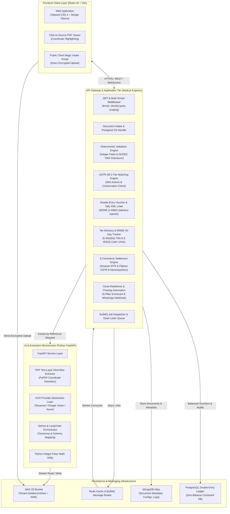

# 🤖 CKsFinBot — Autonomous Accounting & Statutory Tax Advisory Platform

<div align="center">


[](https://nodejs.org/)
[](https://react.dev/)
[](https://python.org/)
[](https://fastapi.tiangolo.com/)
[](https://tailwindcss.com/)
[](https://mongodb.com/)
[](https://www.postgresql.org/)
[](https://bullmq.io/)
[](#-synthetic-evaluation--ci-gate)

*An autonomous, correctness-first accounting and statutory compliance platform for Chartered Accountants, corporate finance teams, and modern Indian enterprises.*

</div>

---

## 🌟 The Product Promise

> **"No unverified number reaches the books."**

In financial accounting and statutory compliance, probabilistic "hallucinations" cause tax scrutiny notices, non-compliance penalties, and severe disallowances. Unlike generic OCR/AI tools that make unverified claims of "100% extraction accuracy", **CKsFinBot** is built on deterministic financial invariants:
1. Every entry is **deterministically validated** or **human-approved**.
2. Every number is **traceable to its exact source bounding box** on the document canvas.
3. Accounting accuracy is **measurable, observable, and strictly audited**.
4. **Money is never a float** — all monetary math is computed in 64-bit integer paise with explicit rounding conservation.

---

## 🏗️ System Architecture



---

## 📚 Complete SDLC Documentation Suite

The complete engineering, business, and operational documentation suite is located in the [`docs/`](file:///d:/WORK/Project/CKsFinBot/docs/) directory:

| Document | Description | Direct Link |
| :--- | :--- | :--- |
| **BRD** | Business Requirements Document: Problem statement, regulatory alignment, user personas, success criteria | [`docs/01_BRD.md`](file:///d:/WORK/Project/CKsFinBot/docs/01_BRD.md) |
| **SRS** | Software Requirements Specification: IEEE 830 standard, 10 non-negotiable invariants, FRs & NFRs | [`docs/02_SRS.md`](file:///d:/WORK/Project/CKsFinBot/docs/02_SRS.md) |
| **Architecture** | System Architecture & Design: High-level diagrams, C4 models, data flows, state machines, subsystems | [`docs/03_SYSTEM_ARCHITECTURE.md`](file:///d:/WORK/Project/CKsFinBot/docs/03_SYSTEM_ARCHITECTURE.md) |
| **Database Design** | Data Architecture: Polyglot persistence, MongoDB schemas, PostgreSQL zero-balance triggers, ER diagram | [`docs/04_DATABASE_DESIGN.md`](file:///d:/WORK/Project/CKsFinBot/docs/04_DATABASE_DESIGN.md) |
| **API Specification** | Complete REST API Reference: Multi-tenant headers, endpoints, request payloads, response schemas | [`docs/05_API_SPECIFICATION.md`](file:///d:/WORK/Project/CKsFinBot/docs/05_API_SPECIFICATION.md) |
| **Security & DPDP** | Security Guide: Multi-tenant boundary isolation, maker-checker dual-control, DPDP Act 2023 compliance | [`docs/06_SECURITY_COMPLIANCE_DPDP.md`](file:///d:/WORK/Project/CKsFinBot/docs/06_SECURITY_COMPLIANCE_DPDP.md) |
| **QA Strategy** | Quality Assurance: 36 invariant unit test suites, synthetic noise injection, CI evaluation gate (FAR 0.00%) | [`docs/07_QA_TEST_STRATEGY.md`](file:///d:/WORK/Project/CKsFinBot/docs/07_QA_TEST_STRATEGY.md) |
| **DevOps Runbook** | Deployment & Operations: Local startup runbook, Docker compose, BullMQ DLQ recovery, incident runbooks | [`docs/08_DEPLOYMENT_DEVOPS_RUNBOOK.md`](file:///d:/WORK/Project/CKsFinBot/docs/08_DEPLOYMENT_DEVOPS_RUNBOOK.md) |

---

## ⚡ Core Feature Highlights

### 1. Click-to-Source & Deterministic Validation Engine
- **Text-Layer Word Geometry**: Extracts coordinates directly from PDF vector text streams. OCR is used only when text layers are absent.
- **Bi-directional Highlighting**: Clicking any extracted field highlights its bounding box on the original PDF canvas; clicking a document region selects the field.
- **Pure Invariant Validation**:
  - Line items sum to voucher taxable value within integer paise tolerance.
  - Invariant GSTIN checksum verification using the **ISO/IEC 7064 MOD 36-2** algorithm.
  - Automatic tax split validation: Intra-state (50/50 CGST + SGST) vs Inter-state (100% IGST).
  - Effective-dated HSN/SAC rate tables sourced from official statutory notifications.
  - Section 17(5) blocked credit review flag for restricted goods and services.

### 2. GSTR-2B 2-Tier Reconciliation & IMS
- **Tier-1 Exact Matching**: Matches purchase register records to GSTN GSTR-2B inward supplies on Supplier GSTIN, normalized invoice number, date, and amounts.
- **Tier-2 Assisted Fuzzy Matching**: Alphanumeric invoice normalization (stripping slashes, hyphens, leading zeros) and amount tolerances ($\le$ ₹1.00). Fuzzy matches require explicit human confirmation.
- **Conservation of Records**: $\text{Matched} + \text{Unmatched} \equiv \text{Purchase Register Total}$. If conservation fails, the recon job is aborted.
- **Invoice Management System (IMS)**: Take `Accept`, `Reject`, `Pending`, or `No Action` decisions directly from the workspace.

### 3. TallyPrime Double-Entry XML Exporter
- **Zero-Balance Guarantee**: Strict adherence to TallyPrime polarity: Debits are output as **negative** amounts and Credits as **positive** amounts, ensuring $\sum \text{Entries} \equiv 0$.
- **MSME Section 43B(h) Injection**: Injects `<ISMSMEDECLARATION>`, `<UDYAMREGISTRATIONNUMBER>`, and statutory due date (capped at 45 days under written agreement, or 15 days without agreement).
- **Pre-Export Schema Linter**: Validates XML structure and rejects unbalanced or polarity-inverted vouchers.

### 4. Statutory Tax Advisory Engine
- **Section 40(a)(ia) TDS Analysis**: Flags payments exceeding thresholds under Sections 194C, 194J, 194I, or 194Q without TDS deduction, warning of 30% expenditure disallowance.
- **Section 40A(3) Cash Limits**: Identifies cash payments exceeding ₹10,000 per person per day (₹35,000 for freight carriage) for 100% disallowance.
- **Section 43B(h) MSME 45-Day Tracker**: Live countdown of days remaining on MSME vendor bills with year-end add-back alerts.

### 5. Month-End Close Readiness & WhatsApp Chasing
- **5-Pillar Scorecard (0–100%)**: Tracks Bank Reconciliation (25%), GSTR-2B Matching (25%), Expense Approvals (20%), Tax Compliance (15%), and MSME Status (15%).
- **Automated Document Chasing**: Identifies missing recurring bills (rent, electricity, internet) and drafts WhatsApp/Email follow-ups with secure magic upload links.
- **Digital Hash & Watermark**: Reports under 100% readiness automatically bear a prominent `PROVISIONAL` watermark.

### 6. Enterprise Practice Controls & Dual-Control
- **Maker-Checker Segregation**: High-value transactions ($\ge$ ₹1,00,000) require secondary sign-off by a Checker (`makerUserId !== checkerUserId`).
- **Append-Only Provenance**: Full audit trail recording who edited what, when, old/new values, and model versions.

### 7. E-Commerce Marketplace Settlement Engine
- **Amazon & Flipkart Decomposition**: Automatically parses Amazon MTR/Settlement reports and Flipkart GSTR-8 statements.
- **Integer Paise Precision**: Breaks down gross sales, returns, commission fees, shipping fees, storage, TCS (§ 52), and TDS (§ 194-O) into balanced journal vouchers.

---

## 🔒 10 Non-Negotiable Correctness Principles

1. **Money is Never a Float**: All amounts are stored and calculated as 64-bit integer paise.
2. **Extract by Reference**: Field values are copied verbatim from document text tokens or OCR bounding boxes.
3. **Posting Gates**: 100% of newly uploaded documents require human review by default.
4. **Append-Only Audit and Provenance**: Ledger vouchers and audit histories are immutable. Corrections create new revisions.
5. **Rules are Versioned Data, Not Code**: Tax rules live in an external versioned registry with effective dates.
6. **Double-Entry Ledger Integrity**: Every voucher must satisfy $\sum \text{Debits} = \sum \text{Credits}$.
7. **Multi-Tenant Context Scoping**: Every query is strictly isolated by `firmId` and `clientId`.
8. **Processing Idempotency**: SHA-256 file hashes and canonical invoice identity keys prevent duplicates.
9. **Async Worker Queues**: Heavy parsing runs via BullMQ/Redis with dead-letter queue (DLQ) support.
10. **Honest Uncertainty**: Missing statutory data evaluates to `"Not Checked"`, never falsely reporting `"Pass"`.

---

## 💻 Tech Stack

| Tier | Technologies |
| :--- | :--- |
| **Frontend** | React 19, Vite, Tailwind CSS 4, Framer Motion, Lucide React, Axios, CSS Design Tokens |
| **Node.js Backend** | Express.js 4.21, Mongoose 8.9, pg (PostgreSQL Client), BullMQ, Redis, Multer, AWS SDK S3 |
| **Python AI Service** | FastAPI, PyPDF, Google Gemini API, LangChain, Tesseract OCR Provider |
| **Data Persistence** | MongoDB Atlas, PostgreSQL 16, AWS S3 (KMS Encrypted), Redis 7 |
| **Testing & CI** | Native Node.js Test Runner, Invariant Test Harness, Synthetic Noise Generator, CI Gate |

---

## 🚀 Quick Start Guide

### Prerequisites
- Node.js 18+ and npm
- Python 3.10+ and pip
- Redis (local daemon or Docker)
- MongoDB instance (local or Atlas)
- PostgreSQL 16 instance (optional for double-entry SQL ledger)

### 1. Clone the Repository
```bash
git clone https://github.com/KrishChothani/CKsFinBot.git
cd CKsFinBot
```

### 2. Configure Environment Files
Create `.env` files in each tier (refer to [`docs/08_DEPLOYMENT_DEVOPS_RUNBOOK.md`](file:///d:/WORK/Project/CKsFinBot/docs/08_DEPLOYMENT_DEVOPS_RUNBOOK.md) for full options):

```bash
# Node-Backend/.env
PORT=8000
MONGODB_URI=mongodb://localhost:27017/cksfinbot
REDIS_HOST=localhost
REDIS_PORT=6379
JWT_SECRET=super_secret_jwt_key_min_32_characters
AWS_REGION=ap-south-1
AWS_S3_BUCKET=cksfinbot-vault
PYTHON_AI_SERVICE_URL=http://localhost:8001
```

```bash
# Python-Backend/.env
HOST=0.0.0.0
PORT=8001
GEMINI_API_KEY=your_gemini_api_key
```

```bash
# Frontend/.env
VITE_API_BASE_URL=http://localhost:8000/api/v1
```

### 3. Start Infrastructure & Services

#### Start Redis
```bash
docker run -d --name cksfinbot-redis -p 6379:6379 redis:7-alpine
```

#### Start Python AI Microservice (Port 8001)
```bash
cd Python-Backend
python -m venv .venv
# Windows: .venv\Scripts\activate | Linux/macOS: source .venv/bin/activate
pip install -r requirements.txt
uvicorn app.main:app --host 0.0.0.0 --port 8001 --reload
```

#### Start Node.js API Service (Port 8000)
```bash
cd Node-Backend
npm install
npm run dev
```

#### Start Frontend Web Application (Port 5173)
```bash
cd Frontend
npm install
npm run dev
```

The application is now accessible at **`http://localhost:5173`**.

---

## 🧪 Testing & Verification

### Run 36 Pure Invariant Unit Tests
```bash
cd Node-Backend
node --test "src/**/*.test.js"
```
*Executes all 36 tests across the 9 invariant suites (Paise math, GSTIN checksum, Tax split, Tally balance, GSTR-2B matching, Marketplace settlement, Close readiness, Client summary, Duplicate detector) with 0 failures.*

### Run Synthetic CI Evaluation Gate
```bash
cd Node-Backend
node src/Eval/ciGate.js
```
*Injects corrupted synthetic invoices and asserts that the False-Accept Rate (FAR) remains **0.00%**.*

### Run Frontend Production Build
```bash
cd Frontend
npm run build
```
*Compiles the React application with Vite, validating JSX syntax, design tokens, and tree-shaking.*

---

## 📁 Directory Structure Tour

```
CKsFinBot/
├── docs/                               # 📚 Complete SDLC Documentation Suite
│   ├── 01_BRD.md                       # Business Requirements Document
│   ├── 02_SRS.md                       # Software Requirements Specification (IEEE 830)
│   ├── 03_SYSTEM_ARCHITECTURE.md       # Architecture Design & C4 Models
│   ├── 04_DATABASE_DESIGN.md           # MongoDB & PostgreSQL Schemas
│   ├── 05_API_SPECIFICATION.md         # REST & Microservices API Reference
│   ├── 06_SECURITY_COMPLIANCE_DPDP.md  # Security, Dual-Control & DPDP Act
│   ├── 07_QA_TEST_STRATEGY.md          # QA Strategy & Invariant Testing
│   └── 08_DEPLOYMENT_DEVOPS_RUNBOOK.md # Operations, Docker & Runbooks
├── Frontend/                           # ⚛️ React 19 Frontend Application
│   ├── src/
│   │   ├── components/ui/              # Design Token Components (Button, Card, Badge, etc.)
│   │   ├── JSX/Components/             # Core Feature Views (Review, Recon, Advisory, etc.)
│   │   ├── pages/                      # Application Page Outlets
│   │   ├── services/apiClient.js       # Centralized Axios API Client
│   │   └── index.css                   # CSS Design Tokens (Light & Dark themes)
├── Node-Backend/                       # 🟢 Express.js API & Business Tier
│   ├── src/
│   │   ├── Controllers/                # Route Controllers
│   │   ├── Eval/                       # CI Evaluation Gate & Synthetic Data Generator
│   │   ├── Middlewares/                # JWT Auth & Multi-Tenant Scoping
│   │   ├── Models/                     # Mongoose Schemas (Document, Voucher, Client, etc.)
│   │   ├── PostgreSQL/                 # PostgreSQL Double-Entry DDL & Trigger Constraints
│   │   ├── Queues/                     # BullMQ Queue Workers & Job Processors
│   │   ├── Routes/                     # REST Route Definitions
│   │   ├── Rules/                      # Deterministic Validation Engine & Statutory Registry
│   │   ├── Services/                   # Business Services (Tally, Recon, Advisory, etc.)
│   │   └── Utils/                      # Integer Paise Money Engine (money.js)
├── Python-Backend/                     # 🐍 FastAPI AI & Document Processing
│   ├── app/
│   │   ├── api/endpoints.py            # AI Microservice RPC Endpoints
│   │   ├── core/money.py               # Python Integer Paise Engine
│   │   ├── services/text_layer_extractor.py # PDF Text-Layer Word Bounding Box Extractor
│   │   └── services/llm_service.py     # Gemini & LangChain Integration
└── README.md                           # Master Project Documentation
```

---

## 📄 License & Authors

- **Platform Architect & Engineering**: Team CKsFinBot / Krish Chothani
- **License**: ISC / Proprietary Fintech Platform
- **Statutory Notice**: Tax rules, Section 43B(h) thresholds, and GSTR-2B specifications align with published notifications by the Ministry of Finance and GSTN (AY 2026-27).
