# 🤖 CKsFinBot — Autonomous Accounting & Statutory Tax Advisory Platform
### Production-Grade Event-Driven Microservices Architecture (v2.0)

<div align="center">


[](https://nodejs.org/)
[](https://react.dev/)
[](https://python.org/)
[](https://fastapi.tiangolo.com/)
[](https://www.rabbitmq.com/)
[](https://www.postgresql.org/)
[](https://mongodb.com/)
[](https://www.docker.com/)

*An autonomous, correctness-first accounting, statutory audit, and tax advisory platform for Chartered Accountants, corporate finance teams, and modern Indian enterprises.*

</div>

---

## 🌟 The Product Invariants

> **"No unverified number reaches the books."**

In financial accounting and statutory compliance, probabilistic "hallucinations" cause tax scrutiny notices, non-compliance penalties, and severe disallowances. **CKsFinBot** enforces strict mathematical, regulatory, and architectural invariants across all 10 bounded microservices contexts:
1. **Zero Floating-Point Drift**: Money is never a float — all monetary transactions are represented and computed in 64-bit integer paise.
2. **Zero LLM Financial Arithmetic**: Statutory rules (GSTIN MOD 36-2 checksum, POS intra/inter-state splits, TDS thresholds, Section 17(5) blocked ITC) are evaluated by pure deterministic code engines.
3. **Double-Entry Balance Guarantee**: At both database and application layers, $\sum \text{Debits} \equiv \sum \text{Credits}$. Unbalanced transactions are rejected.
4. **Maker-Checker Dual Control**: Strict segregation of duties prevents self-approval (`makerUserId !== checkerUserId`).
5. **Decoupled Event-Driven Backbone**: Microservices communicate asynchronously through a durable AMQP 0-9-1 topic exchange (`cksfinbot.events`) with dead-letter exchange (`cksfinbot.dlx`) and Transactional Outbox pattern.

---

## 🏗️ Target Microservices Architecture

```mermaid
flowchart TB
    subgraph ClientTier["Frontend Tier (React 19 + Vite)"]
        UI["Web App (Port 5173)\nReview Queue • 2B Matcher • Tax Advisory • Close Dashboard"]
    end

    subgraph GatewayTier["API Gateway & Reverse Proxy (Port 8000)"]
        Gateway["Express Gateway (Port 8000)\nCorrelation ID Injection • Tenant Propagation • Rate Limiting"]
    end

    subgraph EventBroker["AMQP 0-9-1 Event Broker (RabbitMQ)"]
        TopicEx["Topic Exchange\ncksfinbot.events"]
        DLX["Dead Letter Exchange\ncksfinbot.dlx"]
        DLQ["Dead Letter Queue\ncksfinbot.dlq"]
        TopicEx -.->|Rejected / Unroutable| DLX
        DLX --> DLQ
    end

    subgraph ServicesTier["10 Independently Deployable Microservices"]
        S1["Identity & Tenant Service\n(Port 8001)\nJWT • RBAC • Multi-Tenant"]
        S2["Document Vault Service\n(Port 8002)\nS3 • SHA-256 Idempotency • Outbox"]
        S3["AI Extraction & OCR Service\n(Port 8003 - Python FastAPI)\nPyMuPDF • Gemini • Coordinate Geometry"]
        S4["Validation & Rules Service\n(Port 8004)\nISO/IEC 7064 • POS Split • § 17(5)"]
        S5["Double-Entry Ledger Service\n(Port 8005)\nPostgreSQL 16 • Balanced Vouchers • Maker-Checker"]
        S6["GSTR-2B Recon & IMS Service\n(Port 8006)\n2-Tier Matcher • Record Conservation • IMS"]
        S7["Tax Advisory & MSME Service\n(Port 8007)\n§ 43B(h) 45-Day • § 40A(3) • § 40(a)(ia)"]
        S8["Marketplace Settlement Service\n(Port 8008)\nAmazon MTR • Flipkart GSTR-8 • TCS/TDS"]
        S9["Close Readiness & Chasing Service\n(Port 8009)\n5-Pillar Score • Digital Hash • WhatsApp/Email"]
        S10["ERP & Tally Export Service\n(Port 8010)\nBalanced XML • Polarity Enforcement • Linter"]
    end

    subgraph DataTier["Polyglot Persistence Layer"]
        PG[(PostgreSQL 16\nLedger & Rules)]
        MGO[(MongoDB 8.0\nDocs, Vault, Recon)]
        RDS[(Redis 7\nCache & Extraction)]
        S3B[(AWS S3\nKMS Vault)]
    end

    ClientTier -->|HTTP REST / WebSocket| Gateway
    Gateway -->|/api/v1/users, firms, clients| S1
    Gateway -->|/api/v1/documents, s3, portal| S2
    Gateway -->|/api/v1/vouchers, approvals| S5
    Gateway -->|/api/v1/gst-reconciliation| S6
    Gateway -->|/api/v1/tax-advisory, compliance| S7
    Gateway -->|/api/v1/marketplace-settlements| S8
    Gateway -->|/api/v1/close-readiness, summaries| S9
    Gateway -->|/api/v1/exports| S10

    S2 -->|Publish: cksfinbot.document.ingested| TopicEx
    TopicEx -->|Consume: ai.document-ingested.q| S3
    S3 -->|Publish: cksfinbot.extraction.completed| TopicEx
    TopicEx -->|Consume: validation.document-extracted.q| S4
    S4 -->|Publish: cksfinbot.validation.passed| TopicEx
    TopicEx -->|Consume: ledger.document-validated.q| S5
    S5 -->|Publish: cksfinbot.voucher.committed| TopicEx
    TopicEx -->|Consume: recon.voucher-committed.q| S6
    TopicEx -->|Consume: tax.voucher-committed.q| S7
    TopicEx -->|Consume: export.voucher-committed.q| S10
    TopicEx -->|Consume: close.events.q| S9

    S1 --- MGO
    S2 --- MGO
    S2 --- S3B
    S3 --- RDS
    S5 --- PG
    S6 --- MGO
```



---

## 📋 Microservices Registry & Port Directory

| # | Microservice | Directory | Port | Primary Tech | Key Responsibilities |
| :-: | :--- | :--- | :-: | :--- | :--- |
| **0** | **API Gateway** | `apps/api-gateway` | **8000** | Express, Proxy, CORS | Central ingress, correlation ID tracing, tenant propagation |
| **1** | **Identity & Tenant** | `services/identity-service` | **8001** | Node.js, Express, Mongo | User auth, JWT issuance/rotation, firm & client scoping, RBAC |
| **2** | **Document Vault** | `services/document-service` | **8002** | Node.js, Express, S3 | Secure upload, SHA-256 duplicate detection, Transactional Outbox |
| **3** | **AI Extraction & OCR** | `services/ai-extraction-service` | **8003** | Python FastAPI, PyMuPDF | Text-layer coordinate boxes, table extraction, Gemini mapping |
| **4** | **Validation & Rules** | `services/validation-service` | **8004** | Node.js, Express | MOD 36-2 GSTIN checksum, integer paise math, § 17(5) detector |
| **5** | **Double-Entry Ledger** | `services/ledger-service` | **8005** | Node.js, PostgreSQL 16 | ACID transactions, deferred constraint trigger, Maker-Checker |
| **6** | **GSTR-2B Recon & IMS** | `services/reconciliation-service` | **8006** | Node.js, Express, Mongo | 2-Tier matching, record conservation, IMS Accept/Reject |
| **7** | **Tax Advisory & MSME** | `services/tax-advisory-service` | **8007** | Node.js, Express | § 43B(h) 45-day cap, § 40A(3) cash limits, § 40(a)(ia) TDS |
| **8** | **Marketplace Settlement** | `services/marketplace-service` | **8008** | Node.js, Express | Amazon MTR & Flipkart parsing, 1% TCS/TDS, journal vouchers |
| **9** | **Close Readiness & Chasing** | `services/close-readiness-service` | **8009** | Node.js, Express | 5-Pillar scorecard, SHA-256 digital hash, WhatsApp templates |
| **10** | **ERP & Tally Export** | `services/tally-export-service` | **8010** | Node.js, Express | Balanced Tally XML, negative debits / positive credits, linter |

---

## 📡 Event Catalog & AMQP Routing Keys

All domain events inherit the universal event envelope from `@cksfinbot/event-contracts`:
```json
{
  "eventId": "uuid-v4",
  "eventType": "DocumentExtractedEvent",
  "occurredAt": "2026-11-14T04:00:00.000Z",
  "producer": "ai-extraction-service",
  "tenant": { "firmId": "firm-101", "clientId": "client-202" },
  "correlationId": "trace-999",
  "payload": { ... }
}
```

| Event Type | Producer | AMQP Routing Key | Consumer Queues |
| :--- | :--- | :--- | :--- |
| `DocumentUploadedEvent` | `document-service` | `cksfinbot.document.uploaded` | Audit log |
| `DocumentIngestedEvent` | `document-service` | `cksfinbot.document.ingested` | `ai.document-ingested.q`, `close.events.q` |
| `DocumentDuplicateDetectedEvent` | `document-service` | `cksfinbot.document.duplicate` | Notification |
| `DocumentExtractionStartedEvent` | `ai-extraction-service`| `cksfinbot.extraction.started` | Dashboard WebSocket |
| `DocumentExtractedEvent` | `ai-extraction-service`| `cksfinbot.extraction.completed` | `validation.document-extracted.q` |
| `DocumentExtractionFailedEvent` | `ai-extraction-service`| `cksfinbot.extraction.failed` | Review Queue Alert |
| `DocumentValidatedEvent` | `validation-service` | `cksfinbot.validation.passed` | `ledger.document-validated.q` |
| `DocumentValidationFailedEvent` | `validation-service` | `cksfinbot.validation.failed` | Manual Review Queue |
| `VoucherCreatedEvent` | `ledger-service` | `cksfinbot.voucher.created` | Audit Trail |
| `VoucherApprovalRequestedEvent` | `ledger-service` | `cksfinbot.voucher.approval_requested` | Senior CA / Partner Inbox |
| `VoucherApprovedEvent` | `ledger-service` | `cksfinbot.voucher.approved` | Notification |
| `VoucherCommittedEvent` | `ledger-service` | `cksfinbot.voucher.committed` | `recon.voucher-committed.q`, `tax.voucher-committed.q`, `export.voucher-committed.q`, `close.events.q` |
| `GSTR2BReconciliationCompletedEvent` | `reconciliation-service`| `cksfinbot.recon.completed` | `close.events.q` |
| `IMSActionRecordedEvent` | `reconciliation-service`| `cksfinbot.recon.ims_action` | GST Portal Sync Worker |
| `TaxRiskDetectedEvent` | `tax-advisory-service`| `cksfinbot.tax.risk_detected` | `close.events.q`, CA Advisory Alert |
| `MSMEOverdueEvent` | `tax-advisory-service`| `cksfinbot.tax.msme_overdue` | Chasing Bot Worker |
| `MarketplaceSettlementImportedEvent`| `marketplace-service` | `cksfinbot.marketplace.imported` | Settlement Log |
| `MarketplaceVoucherGeneratedEvent` | `marketplace-service` | `cksfinbot.marketplace.voucher_generated`| `ledger.document-validated.q` |
| `CloseReadinessUpdatedEvent` | `close-readiness-service`| `cksfinbot.close.updated` | Client Dashboard |
| `MissingDocumentDetectedEvent` | `close-readiness-service`| `cksfinbot.close.missing_doc` | WhatsApp Chasing Dispatcher |
| `TallyExportGeneratedEvent` | `tally-export-service`| `cksfinbot.export.tally_generated` | Download Center |
| `UserCreatedEvent` | `identity-service` | `cksfinbot.identity.user_created` | User Profile & Audit |
| `TenantCreatedEvent` | `identity-service` | `cksfinbot.identity.tenant_created` | Workspace Provisioner |

---

## 🚀 Step-by-Step Startup Commands

### Option A: Complete Microservices Platform via Docker Compose (Recommended)

1. **Clone the repository**:
   ```bash
   git clone https://github.com/KrishChothani/CKsFinBot.git
   cd CKsFinBot
   ```

2. **Start Infrastructure & Message Broker**:
   ```bash
   docker compose up -d rabbitmq redis mongodb postgres
   ```
   - RabbitMQ Management UI: [http://localhost:15672](http://localhost:15672) (`guest` / `guest`)
   - PostgreSQL 16: `localhost:5432` (`cksfinbot_ledger`)
   - MongoDB 8.0: `localhost:27017` (`cksfinbot`)
   - Redis 7: `localhost:6379`

3. **Launch All 10 Microservices & Central API Gateway**:
   ```bash
   docker compose up --build
   ```
   API Gateway is listening on **`http://localhost:8000`**.

4. **Launch Frontend Web Application**:
   ```bash
   cd Frontend
   npm install
   npm run dev
   ```
   Open **`http://localhost:5173`** in your browser.

---

### Option B: Local Development (Individual Services)

You can launch any service independently in local development:

```bash
# 1. API Gateway (Port 8000)
cd apps/api-gateway && npm run dev

# 2. Identity Service (Port 8001)
cd services/identity-service && npm run dev

# 3. Document Service (Port 8002)
cd services/document-service && npm run dev

# 4. AI Extraction Service (Port 8003 - Python)
cd services/ai-extraction-service
python -m uvicorn app.main:app --port 8003 --reload

# 5. Validation Service (Port 8004)
cd services/validation-service && npm run dev

# 6. Ledger Service (Port 8005)
cd services/ledger-service && npm run dev

# 7. Reconciliation Service (Port 8006)
cd services/reconciliation-service && npm run dev

# 8. Tax Advisory Service (Port 8007)
cd services/tax-advisory-service && npm run dev

# 9. Marketplace Service (Port 8008)
cd services/marketplace-service && npm run dev

# 10. Close Readiness Service (Port 8009)
cd services/close-readiness-service && npm run dev

# 11. Tally Export Service (Port 8010)
cd services/tally-export-service && npm run dev
```

---

## 🧪 Comprehensive Verification & Test Suite

The platform includes **100% automated test coverage** across all shared contracts, middleware, gateway routes, legacy regression suites, and all 10 independent microservices.

### 1. Run Complete Platform Verification
```bash
npm run test:all
```
*Executes all test suites across `@cksfinbot/event-contracts`, `@cksfinbot/event-bus`, `@cksfinbot/shared-middleware`, `@cksfinbot/shared-logger`, `api-gateway`, and all microservices.*

### 2. Run All 10 Microservice Test Suites
```bash
npm run test:microservices
```

### 3. Run Python AI Extraction Service Tests
```bash
npm run test:ai
```

### 4. Run Legacy Regression Test Suite (36 Invariant Tests)
```bash
npm run test:legacy
```

### 5. Run Frontend Production Build Check
```bash
cd Frontend && npm run build
```

---

## 📚 Complete SDLC & Architecture Documentation Suite

Detailed architectural blueprints, design documents, and audit logs are available in [`docs/`](file:///d:/WORK/Project/CKsFinBot/docs/):

| Document | Description | Direct Link |
| :--- | :--- | :--- |
| **Migration Plan** | 12-Stage Strangler Fig Microservices Migration Plan | [`docs/architecture/MICROSERVICE_MIGRATION_PLAN.md`](file:///d:/WORK/Project/CKsFinBot/docs/architecture/MICROSERVICE_MIGRATION_PLAN.md) |
| **Dependency Map** | Cross-Domain Dependency & Decoupling Map | [`docs/architecture/CURRENT_DEPENDENCY_MAP.md`](file:///d:/WORK/Project/CKsFinBot/docs/architecture/CURRENT_DEPENDENCY_MAP.md) |
| **Repository Audit** | Architectural & Invariant Audit Report | [`docs/architecture/REPOSITORY_AUDIT.md`](file:///d:/WORK/Project/CKsFinBot/docs/architecture/REPOSITORY_AUDIT.md) |
| **BRD** | Business Requirements Document (AY 2026-27 Regulatory Spec) | [`docs/01_BRD.md`](file:///d:/WORK/Project/CKsFinBot/docs/01_BRD.md) |
| **SRS** | Software Requirements Specification (IEEE 830 Standard) | [`docs/02_SRS.md`](file:///d:/WORK/Project/CKsFinBot/docs/02_SRS.md) |
| **System Architecture** | C4 Architecture Models, Bounded Contexts, and Sequence Diagrams | [`docs/03_SYSTEM_ARCHITECTURE.md`](file:///d:/WORK/Project/CKsFinBot/docs/03_SYSTEM_ARCHITECTURE.md) |
| **Database Design** | Database-per-Service Polyglot DDL & Zero-Balance Triggers | [`docs/04_DATABASE_DESIGN.md`](file:///d:/WORK/Project/CKsFinBot/docs/04_DATABASE_DESIGN.md) |
| **API Specification** | Central Gateway & Microservices REST/AMQP API Reference | [`docs/05_API_SPECIFICATION.md`](file:///d:/WORK/Project/CKsFinBot/docs/05_API_SPECIFICATION.md) |
| **Security & DPDP** | Multi-Tenant Boundary Isolation & DPDP Act 2023 Guide | [`docs/06_SECURITY_COMPLIANCE_DPDP.md`](file:///d:/WORK/Project/CKsFinBot/docs/06_SECURITY_COMPLIANCE_DPDP.md) |
| **QA Strategy** | Invariant Test Harness, Synthetic Noise Generator, CI Gate | [`docs/07_QA_TEST_STRATEGY.md`](file:///d:/WORK/Project/CKsFinBot/docs/07_QA_TEST_STRATEGY.md) |
| **DevOps Runbook** | Microservices Deployment, Kubernetes & Docker Operations | [`docs/08_DEPLOYMENT_DEVOPS_RUNBOOK.md`](file:///d:/WORK/Project/CKsFinBot/docs/08_DEPLOYMENT_DEVOPS_RUNBOOK.md) |

---

## 📄 License & Authors

- **Platform Architect & Engineering**: Team CKsFinBot / Krish Chothani
- **License**: ISC / Enterprise Fintech Platform
- **Regulatory Alignment**: Indian Statutory Rules (GST Rules, Section 43B(h), Section 40A(3), Section 194C/J/I/Q, Section 17(5)) are versioned and enforced as immutable mathematical invariants.
