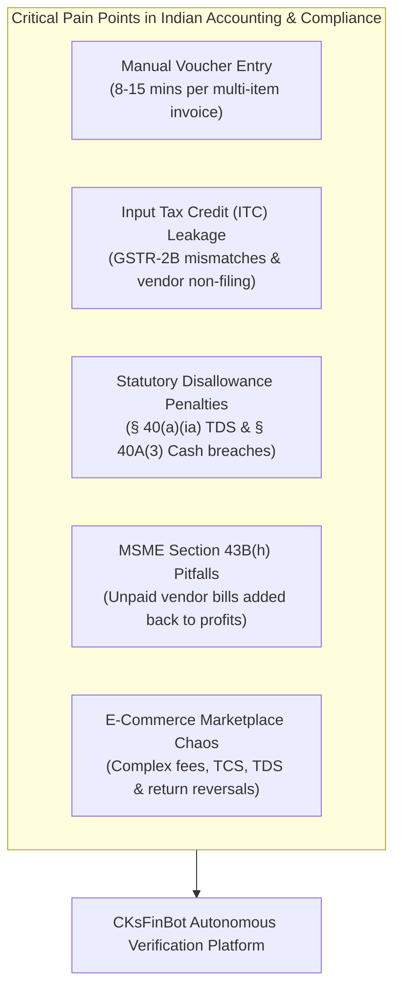
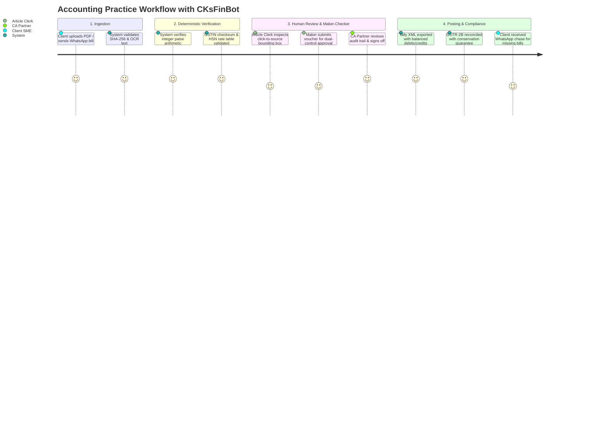
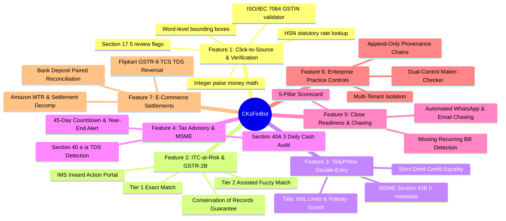

# Business Requirements Document (BRD)
## Project: CKsFinBot — Autonomous Accounting & Statutory Tax Advisory Platform

---

### Document Control
- **Document ID**: BRD-CKSFINBOT-2026.1
- **Version**: 2.0.0
- **Status**: Approved & Baselined
- **Target Audience**: Executive Leadership, Chartered Accountants (CAs), Engineering Leads, Product Managers, Compliance Officers

---

## 1. Executive Summary & Product Promise

### 1.1 The Product Promise
> **"No unverified number reaches the books."**

In financial accounting and statutory compliance, probabilistic outputs and "hallucinated" numbers cause severe tax penalties, disallowances under scrutiny, and compliance liabilities. Unlike generic AI products that claim "100% extraction accuracy", CKsFinBot is engineered with an uncompromising correctness-first promise:
1. Every entry is **deterministically validated** or **human-approved**.
2. Every number is **traceable to its exact source bounding box** in the original document.
3. Accounting accuracy is **measurable, observable, and strictly audited**.
4. **Money is never a float** — all monetary math is computed in integer paise.

---

## 2. Business Problem Statement

Indian SMEs and Chartered Accountancy firms face substantial operational risks and margin compression:

1. **Manual Ingestion Bottleneck**: Accounting practices spend over 60% of their operational time manually transcribing PDFs, paper bills, and bank statements into ERP software like TallyPrime.
2. **Input Tax Credit (ITC) at Risk**: Under Section 16(2)(aa) of the CGST Act, taxpayers cannot claim ITC unless the supplier uploads the invoice to GSTR-1 and it appears in GSTR-2B. Without continuous reconciliation, businesses lose lakhs in ineligible or unclaimed credit.
3. **Severe Income-tax Disallowances**:
   - **Section 40(a)(ia)**: 30% of expenditure is permanently added back to taxable profit if TDS is not deducted under Sections 194C, 194J, 194I, or 194Q.
   - **Section 40A(3)**: 100% disallowance for cash expenditures exceeding ₹10,000 to a single vendor in a day (₹35,000 for freight/carriage).
   - **Section 43B(h)**: All sums payable to Micro and Small Enterprises beyond 15 days (or 45 days under written agreement) that remain unpaid at year-end are disallowed and taxed.
4. **E-Commerce Reconciliation Nightmares**: Marketplace sellers on Amazon and Flipkart receive aggregated settlements netting off commissions, shipping, logistics, TCS (§ 52), and TDS (§ 194-O). Reconciling these manually into double-entry ledgers is error-prone.

---

## 3. Regulatory Landscape & Statutory Alignment

| Act / Regulation | Sections Covered | Platform Implementation |
| :--- | :--- | :--- |
| **Central Goods & Services Tax (CGST) Act, 2017** | § 16(2)(aa), § 17(5), § 31, § 52 | GSTR-2B 2-tier matching, IMS action tracking, Section 17(5) blocked credit review flag, TCS reconciliation |
| **Income-tax Act, 1961** | § 40(a)(ia), § 40A(3), § 43B(h), § 194C, § 194J, § 194-O | Deterministic disallowance flags, statutory rate tables, threshold monitoring, and daily cash tracking |
| **Micro, Small & Medium Enterprises Development (MSMED) Act, 2006** | § 15, § 16, § 18 | MSME vendor tagging, statutory due-date calculators (15/45-day cap), and compound interest calculations |
| **Digital Personal Data Protection (DPDP) Act, 2023** | § 4, § 6, § 8, § 12 | Per-tenant data boundaries, audit logs, cryptographic shredding, and consent provenance |

---

## 4. User Personas & Stakeholder Journey

### Primary Personas
1. **Chartered Accountant / Partner (Sign-Off & Risk)**:
   - Needs high-level risk scorecards, practice analytics, and a dual-control maker-checker gate for high-value transactions.
2. **Senior Bookkeeper / Article Trainee (The Reviewer)**:
   - Needs a sub-second "Click-to-Source" review interface where extracted values highlight directly on the original document PDF.
3. **Client SME Owner / Finance Manager**:
   - Needs seamless intake (magic portal links, WhatsApp uploads) and real-time close readiness reports without needing an accounting degree.

---

## 5. Scope & Functional Pillar Breakdown

---

## 6. Success Metrics & Non-Negotiable Acceptance Criteria

1. **False-Accept Rate (FAR)**: **0.00%** on synthetic evaluation test cases. Any corrupted total, wrong GST split, or inverted debit/credit must be blocked before posting.
2. **Posting Gate**: 100% of newly uploaded documents require human sign-off unless auto-approval thresholds (precision > 99.8%) are reached.
3. **Double-Entry Invariant**: Every exported voucher must satisfy:
   $$\sum \text{Debit Paise} = \sum \text{Credit Paise}$$
   Vouchers failing this equality cannot be downloaded or synchronized.
4. **Append-Only Immutability**: All corrections, edits, or reviewer approvals generate a new audit log record referencing the prior version hash. Nothing is ever overwritten in place.

