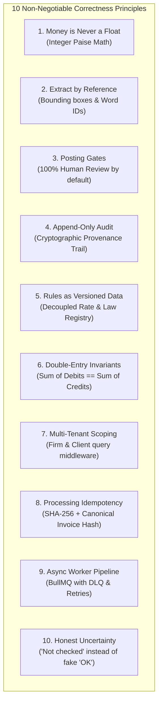
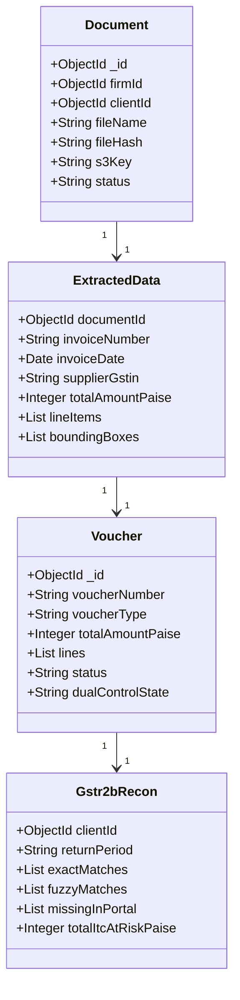

# Software Requirements Specification (SRS)
## Project: CKsFinBot — Autonomous Accounting & Statutory Tax Advisory Platform
### Standard: IEEE 830-1998 Compliant Specification

---

### Document Control
- **Document ID**: SRS-CKSFINBOT-2026.1
- **Version**: 2.0.0
- **Status**: Baselined
- **Author**: Senior Full-Stack Fintech Architect

---

## 1. Introduction

### 1.1 Purpose
This document provides the formal software requirements specification for the CKsFinBot platform. It specifies functional requirements, strict financial correctness invariants, system constraints, performance metrics, and external interfaces for implementation, QA, and validation teams.

### 1.2 Scope
The CKsFinBot system ingests commercial invoices, expense bills, e-commerce settlement statements, and bank records. It extracts text and bounding boxes by reference, executes deterministic statutory checks, enables dual-control human review, reconciles input tax credit with GSTN GSTR-2B records, tracks Section 43B(h) and TDS liabilities, and produces double-entry compliant TallyPrime XML.

### 1.3 Definitions, Acronyms, and Abbreviations
- **ITC**: Input Tax Credit under CGST/SGST/IGST Act, 2017.
- **IMS**: Invoice Management System introduced by GSTN for taking Accept/Reject/Pending actions on inward supplies.
- **FAR**: False-Accept Rate (the proportion of erroneous vouchers approved without detection).
- **Integer Paise**: Monetary representation where ₹1.00 = 100 paise, preventing floating-point rounding errors.
- **Provenance**: Cryptographically verifiable record of who, when, and which model extracted every field.
- **Maker-Checker**: Dual-control security where an author (maker) cannot authorize their own high-value transaction without reviewer (checker) approval.

---

## 2. Overall Description & 10 Non-Negotiable Invariants

1. **Principle 1 (Money is Never a Float)**:
   - Floating-point primitives (`float`, `double`, `Number` with fractions) SHALL NOT be used for currency operations.
   - All amounts SHALL be stored and calculated as 64-bit integer paise (1 Rupee = 100 Paise).
   - Tax split algorithms SHALL guarantee the conservation of paise (i.e. $\text{CGST} + \text{SGST} = \text{Total GST} \pm 0$ paise).
2. **Principle 2 (Extract by Reference)**:
   - Field values SHALL be copied verbatim from PDF text tokens or OCR bounding boxes.
   - If an extracted value cannot be referenced to an exact coordinate on the document page, it SHALL be flagged as `unlocated` and CANNOT be auto-approved.
3. **Principle 3 (Posting Gates)**:
   - Auto-approval is disabled by default for 100% of tenants.
   - Enabling auto-approval requires meeting configurable precision benchmarks (>99.8%) on a per-client, per-vendor basis.
4. **Principle 4 (Append-Only Audit and Provenance)**:
   - Ledger vouchers and audit histories SHALL be immutable.
   - Corrections create a new voucher revision referencing the prior voucher hash and author ID.
5. **Principle 5 (Rules are Versioned Data, Not Code)**:
   - Statutory tax rules (TDS rates, MSME thresholds, cash disallowances) SHALL live in an external versioned JSON registry with effective-from/to dates.
6. **Principle 6 (Ledger Integrity)**:
   - Every voucher SHALL balance to zero: $\sum \text{Debits} - \sum \text{Credits} = 0$.
   - Tally exports and database writes SHALL reject any unbalanced record.
7. **Principle 7 (Tenancy and Security)**:
   - Every database query and S3 bucket operation MUST include explicit `firmId` and `clientId` context.
8. **Principle 8 (Idempotency)**:
   - Duplicate documents (identical file hash or canonical supplier GSTIN + invoice number + date + amount) SHALL be rejected before queue insertion.
9. **Principle 9 (Async Processing)**:
   - Large PDF parsing and LLM operations SHALL execute in asynchronous worker queues (BullMQ/Redis) with dead-letter queue (DLQ) support.
10. **Principle 10 (Honest Uncertainty)**:
    - Missing statutory data or unverified rules SHALL evaluate to `"Not Checked"`, never falsely reporting `"Pass"` or `"OK"`.

---

## 3. Specific Functional Requirements

### Module 1: Document Intake & Click-to-Source (FR-101 – FR-108)
- **FR-101**: System SHALL ingest PDF (vector and scanned), PNG, JPG, JPEG, and TIFF files up to 50MB.
- **FR-102**: System SHALL prioritize the PDF text layer to extract exact word bounding boxes ($x_0, y_0, x_1, y_1$) and page indices.
- **FR-103**: If the text layer is missing or sparse (< 20 characters), system SHALL fall back to OCR via provider abstraction.
- **FR-104**: Every extracted field SHALL store raw text, normalized value, bounding box, page number, confidence score, and location state (`located: true/false`).
- **FR-105**: The UI SHALL support bidirectional click-to-source: clicking an extracted field highlights its box on the PDF canvas; clicking a box selects the corresponding field input.
- **FR-106**: Invariant GSTIN checksum verification SHALL be performed via the ISO/IEC 7064 MOD 36-2 algorithm.
- **FR-107**: Place of supply (first 2 digits of supplier GSTIN vs buyer GSTIN) SHALL deterministically dictate tax split (CGST + SGST vs IGST).
- **FR-108**: Section 17(5) blocked credit keywords (e.g. "motor vehicle", "food and beverages", "beauty treatment", "outdoor catering") SHALL raise a human review flag.

### Module 2: GSTR-2B 2-Tier Reconciliation & IMS (FR-201 – FR-207)
- **FR-201**: System SHALL defensively parse GSTN GSTR-2B JSON and Excel formats with format validation.
- **FR-202**: **Tier-1 Exact Matching**: Match purchase register to GSTR-2B on exact canonical Supplier GSTIN, normalized invoice number, invoice date, and amounts.
- **FR-203**: **Tier-2 Assisted Fuzzy Matching**: Normalize alphanumeric characters (stripping delimiters `/`, `-`, and leading zeros) and apply amount tolerance ($\le$ ₹1.00). Fuzzy matches SHALL NEVER be auto-accepted without human confirmation.
- **FR-204**: System SHALL classify results into: `Matched`, `Missing in 2B (ITC at Risk)`, `In 2B but not in Books`, `Amount Mismatch`, and `Tax Mismatch`.
- **FR-205**: **Conservation Invariant**: $\text{Matched} + \text{Unmatched} \equiv \text{Purchase Register Total}$. If conservation fails, the recon job is aborted.
- **FR-206**: "ITC at Risk" SHALL explicitly track and display the formula: $\sum \text{Tax on purchase-register lines missing in GSTR-2B}$.
- **FR-207**: System SHALL support GSTN Invoice Management System (IMS) actions: `Accept`, `Reject`, `Pending`, and `No Action`.

### Module 3: TallyPrime Double-Entry XML Exporter (FR-301 – FR-306)
- **FR-301**: System SHALL generate TallyPrime-compliant standard XML format (UTF-8) with `<ENVELOPE>`, `<HEADER>`, and `<TALLYMESSAGE>`.
- **FR-302**: **Double-Entry Balance Guarantee**: Debits SHALL be output as negative values and credits as positive values in Tally XML. The sum of all ledger amounts within `<ALLLEDGERENTRIES.LIST>` must equal zero.
- **FR-303**: System SHALL inject MSME Section 43B(h) statutory metadata (`<ISMSMEDECLARATION>`, `<UDYAMREGISTRATIONNUMBER>`, `<STATUTORYDUEDATE>`).
- **FR-304**: Statutory due date SHALL be calculated as:
  $$\text{Due Date} = \text{Invoice Date} + \min(\text{Agreed Days}, 45)$$
  If no agreement exists, due date is capped at 15 days.
- **FR-305**: Built-in Schema Linter SHALL validate XML before file generation. Inverted polarities or unbalanced entries SHALL throw a validation error.
- **FR-306**: System SHALL support batch export for date ranges and client entities.

### Module 4: Statutory Tax Advisory Engine (FR-401 – FR-406)
- **FR-401**: **Section 40(a)(ia) TDS Analysis**: Track contractor payments (§ 194C threshold ₹30,000 single / ₹1,00,000 annual) and professional fees (§ 194J threshold ₹30,000). Highlight 30% expenditure disallowance risk on default.
- **FR-402**: **Section 40A(3) Cash Disallowance**: Aggregate cash expenditures per supplier per day. Disallow 100% of expenditure exceeding ₹10,000 (or ₹35,000 for transport goods carriage).
- **FR-403**: **Section 43B(h) MSME Disallowance**: Flag vendor balances exceeding 45 days at financial year close (March 31) for 100% add-back to taxable income.
- **FR-404**: Flagged items SHALL produce an advisory review note with plain-language explanation and recommended CA corrective action.

### Module 5: Close-Readiness & Chasing Automation (FR-501 – FR-505)
- **FR-501**: System SHALL compute a deterministic 5-pillar close readiness score (0–100%):
  1. Bank Statement Intake & Reconciliation (25%)
  2. GSTR-2B ITC Match Rate (25%)
  3. Expense Bill & Voucher Approvals (20%)
  4. Statutory Tax & TDS Compliance (15%)
  5. MSME 45-Day Payment Status (15%)
- **FR-502**: Score classification SHALL map to states: `Critical Gaps` (<60%), `In Progress` (60–79%), `Near Complete` (80–99%), and `Ready for Sign-Off` (100%).
- **FR-503**: Missing document detector SHALL identify recurring monthly bills (rent, broadband, electricity, cloud hosting) absent in current period.
- **FR-504**: System SHALL generate formatted chasing templates for WhatsApp and Email containing exact invoice references, amount, and secure magic intake links.
- **FR-505**: System SHALL generate a digital hash (SHA-256) of client summary metrics. If score < 100%, reports MUST bear a prominent `PROVISIONAL` watermark.

### Module 6: Enterprise Practice Controls & Dual-Control (FR-601 – FR-605)
- **FR-601**: Multi-tenant context SHALL be enforced across all API endpoints using `firmId` and `clientId` middleware.
- **FR-602**: **Dual-Control Policy (Maker-Checker)**: Transactions above a tenant-configurable monetary threshold (default ₹1,00,000) require secondary sign-off by a designated Checker.
- **FR-603**: Segregation of Duties: A Maker cannot act as Checker on their own voucher.
- **FR-604**: WhatsApp Intake Whitelist: Inbound document intake from WhatsApp webhook SHALL only process numbers registered in the tenant client whitelist.
- **FR-605**: Dual-control actions SHALL be recorded in an immutable audit ledger (`auditLog.model.js`).

### Module 7: E-Commerce Marketplace Settlement Engine (FR-701 – FR-706)
- **FR-701**: System SHALL parse Amazon Merchant Tax Report (MTR) and Settlement flat-files/CSVs.
- **FR-702**: System SHALL parse Flipkart Sales Register and GSTR-8 Settlement reports.
- **FR-703**: Decomposition SHALL compute Gross Sales, Customer Returns, Commission Fees, Logistics/FBA Fees, Storage Fees, Technology Fees, TCS (§ 52), and TDS (§ 194-O) with integer paise precision.
- **FR-704**: Balanced double-entry voucher generation SHALL verify:
  $$\text{Net Bank Deposit} + \text{Expenses} + \text{TCS} + \text{TDS} - \text{Returns} \equiv \text{Gross Sales}$$
- **FR-705**: Bank reconciliation module SHALL automatically match Amazon/Flipkart NEFT/RTGS settlement deposits with the computed net payable.

---

## 4. Non-Functional Requirements (NFR)

| ID | Category | Requirement Specification |
| :--- | :--- | :--- |
| **NFR-101** | **Accuracy** | False-Accept Rate (FAR) SHALL be **0.00%** on validation test suites. |
| **NFR-102** | **Precision** | All currency conversions and tax divisions SHALL produce zero lost paise. |
| **NFR-103** | **Latency** | Document text extraction & bounding box return $\le$ 3.5 seconds for 5-page PDF. |
| **NFR-104** | **Throughput** | Queue pipeline SHALL sustain a minimum of 25 concurrent multi-page documents per worker instance. |
| **NFR-105** | **Security** | DPDP Act 2023 compliant: AES-256 S3 server-side encryption, TLS 1.3 in-transit, 15-minute presigned URLs. |
| **NFR-106** | **Auditability** | 100% of field modifications SHALL persist author, timestamp, old value, and new value in append-only storage. |
| **NFR-107** | **Availability** | Stateless Node.js backend and FastAPI workers designed for 99.9% uptime SLA. |
| **NFR-108** | **UI Responsiveness** | Seamless Light Mode and Dark Mode support using CSS design tokens (`var(--surface)`, `var(--primary)`). |

---

## 5. Traceability Matrix

| Requirement ID | Module | Verification Method | Implemented File |
| :--- | :--- | :--- | :--- |
| **FR-101** | Intake | Automated Test | [`document.routes.js`](file:///d:/WORK/Project/CKsFinBot/Node-Backend/src/Routes/document.routes.js) |
| **FR-106** | Validation | Unit Invariant | [`validator.engine.js`](file:///d:/WORK/Project/CKsFinBot/Node-Backend/src/Rules/validator.engine.js) |
| **FR-202** | Recon | Unit Invariant | [`gstRecon.service.js`](file:///d:/WORK/Project/CKsFinBot/Node-Backend/src/Services/gstRecon.service.js) |
| **FR-302** | Export | Schema Linter | [`tallyExport.service.js`](file:///d:/WORK/Project/CKsFinBot/Node-Backend/src/Services/tallyExport.service.js) |
| **FR-401** | Advisory | Unit Invariant | [`taxAdvisory.service.js`](file:///d:/WORK/Project/CKsFinBot/Node-Backend/src/Services/taxAdvisory.service.js) |
| **FR-501** | Close | Automated Test | [`closeReadiness.service.js`](file:///d:/WORK/Project/CKsFinBot/Node-Backend/src/Services/closeReadiness.service.js) |
| **FR-602** | Enterprise | Middleware Test | [`approval.service.js`](file:///d:/WORK/Project/CKsFinBot/Node-Backend/src/Services/approval.service.js) |
| **FR-703** | Marketplace | Unit Invariant | [`marketplaceSettlement.service.js`](file:///d:/WORK/Project/CKsFinBot/Node-Backend/src/Services/marketplaceSettlement.service.js) |

