# System Architecture & Technical Design (ADD)
## Project: CKsFinBot — Autonomous Accounting & Statutory Tax Advisory Platform

---

### Document Control
- **Document ID**: ARCH-CKSFINBOT-2026.1
- **Version**: 2.0.0
- **Status**: Approved & Baselined
- **Author**: Senior Full-Stack Fintech Architect

---

## 1. High-Level Architecture Overview

CKsFinBot employs a decoupled microservices architecture designed for resilience, strict tenant isolation, deterministic data integrity, and high-throughput document processing.

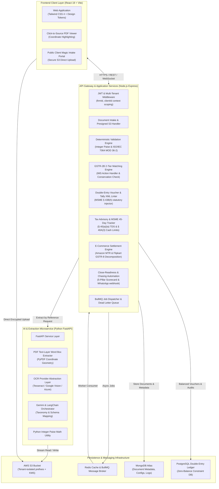

---

## 2. C4 Architecture Models

### 2.1 C4 Level 1: System Context Diagram

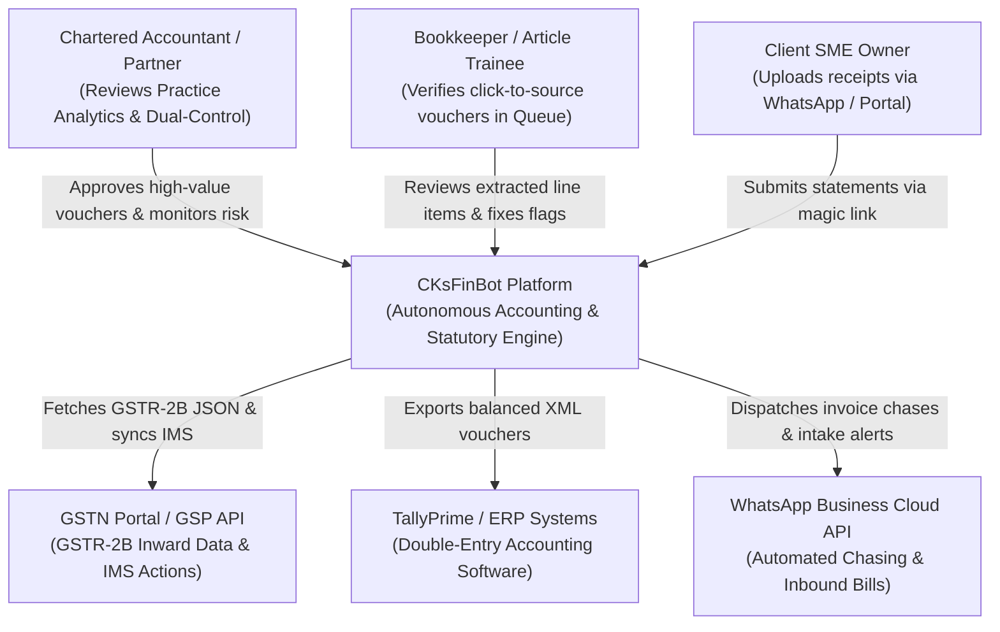

### 2.2 C4 Level 2: Container Diagram

```mermaid
flowchart TB
    subgraph Browser["Client Browser"]
        SPA["React 19 Single Page App\n(Vite, Tailwind CSS, Lucide, Framer Motion)"]
    end

    subgraph AppCluster["Application Tier"]
        NodeAPI["Node.js API Service\n(Express 4.21, Mongoose, BullMQ, pg)"]
        PythonAI["Python AI Service\n(FastAPI, PyPDF, Gemini, LangChain)"]
        Worker["Async Extraction Worker\n(BullMQ Worker Consumer)"]
    end

    subgraph StorageCluster["Data & Message Persistence"]
        RedisDB["Redis 7 (In-Memory Queue & Token Store)"]
        MongoDB["MongoDB 8.0 (Documents, Rules, Clients, Chat)"]
        PostgreSQL["PostgreSQL 16 (Ledgers, Double-Entry Lines, Audits)"]
        S3Storage["AWS S3 (Encrypted Documents & Previews)"]
    end

    SPA -->|REST API Calls (JWT)| NodeAPI
    NodeAPI -->|Dispatches Extraction Task| RedisDB
    RedisDB -->|Pulls Job| Worker
    Worker -->|Calls Extraction RPC| PythonAI
    PythonAI -->|Reads PDF Bytes| S3Storage
    Worker -->|Writes Extracted Coordinates| MongoDB
    NodeAPI -->|Executes Double-Entry Transactions| PostgreSQL
    NodeAPI -->|Generates Signed URLs| S3Storage
```

### 2.3 C4 Level 3: Component Diagram (Node.js Backend Architecture)

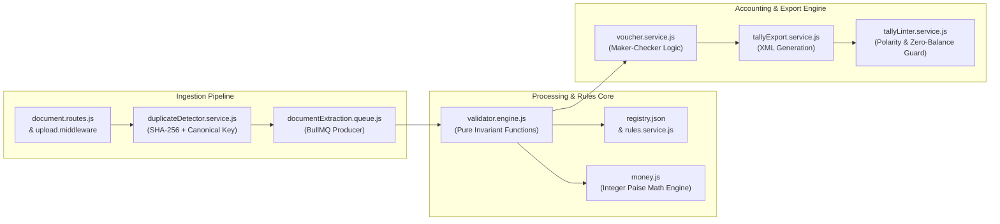

---

## 3. End-to-End Data & Event Flow

### 3.1 Document Ingestion & Verification Sequence

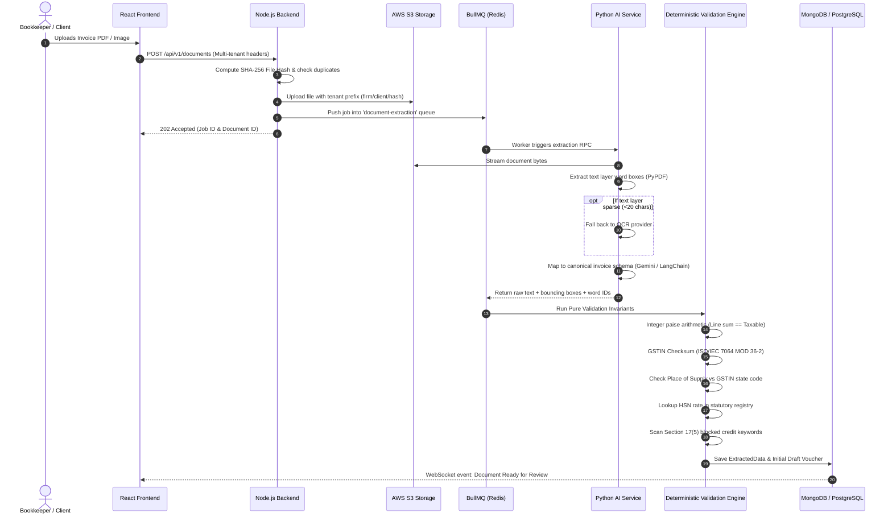

### 3.2 GSTR-2B 2-Tier Reconciliation Sequence

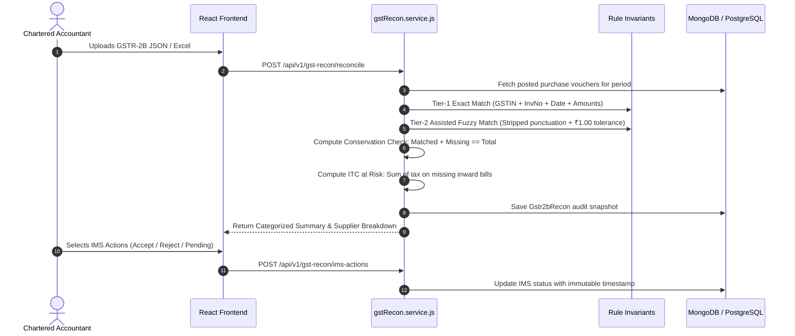

---

## 4. Subsystem Deep-Dive

### 4.1 Deterministic Validation Engine Subsystem
The engine executes **pure functions** without external I/O or side effects. It never relies on probabilistic LLM output for arithmetic, tax calculations, or checksums:

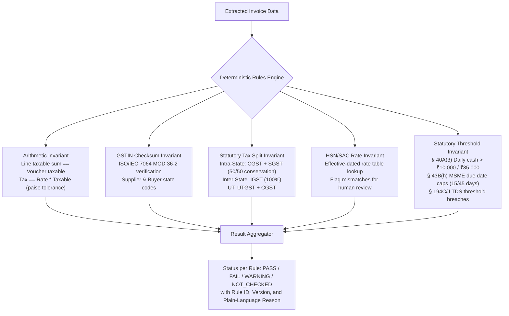

### 4.2 Double-Entry Ledger Subsystem (TallyPrime Integration)
To ensure zero financial discrepancy, vouchers adhere to double-entry bookkeeping polarity rules:

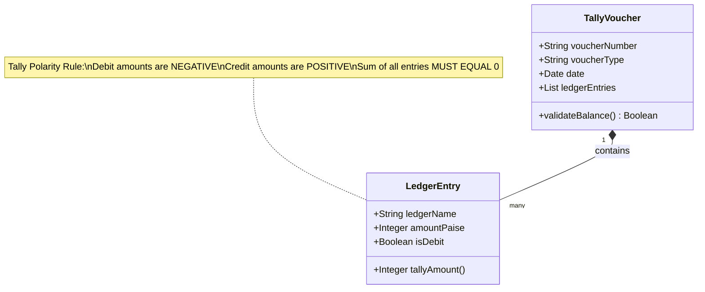

1. **Polarity Enforcement**:
   - Debit line item (Purchase / Expense / Input CGST / Input SGST): Formatted as `-125000` (Negative).
   - Credit line item (Sundry Creditor / Bank / Cash): Formatted as `+125000` (Positive).
   - Result: $\sum \text{Entry amounts} \equiv 0.00$.
2. **MSME Metadata Injection**:
   - Every Sundry Creditor entry is cross-referenced with `client.model.js`.
   - If vendor is Micro/Small, `<ISMSMEDECLARATION>Yes</ISMSMEDECLARATION>` and statutory due date are injected.
3. **Pre-Export Linter**:
   - Scans generated XML DOM.
   - Rejects export if any voucher is unbalanced or debit/credit polarities are inverted.

### 4.3 E-Commerce Marketplace Settlement Subsystem
Decouples complex marketplace remittance flat-files into clear double-entry accounting records:

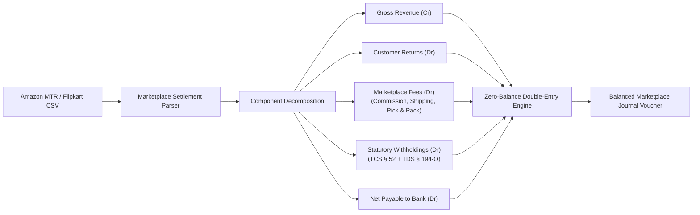

---

## 5. State Machine Specifications

### 5.1 Document Processing Lifecycle

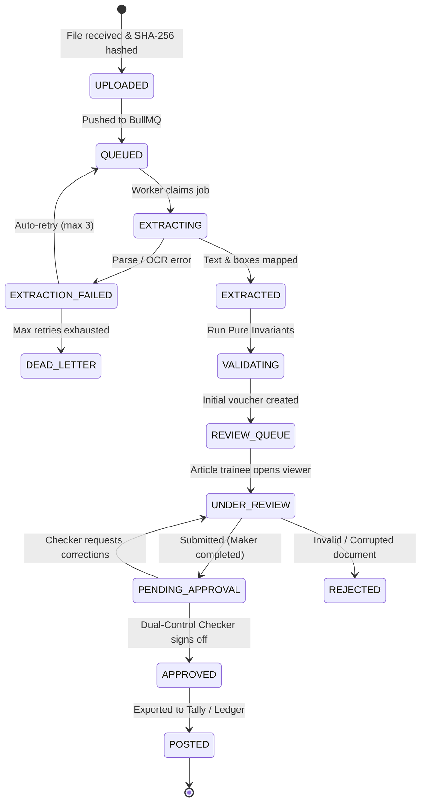

### 5.2 Dual-Control Maker-Checker Approval Lifecycle

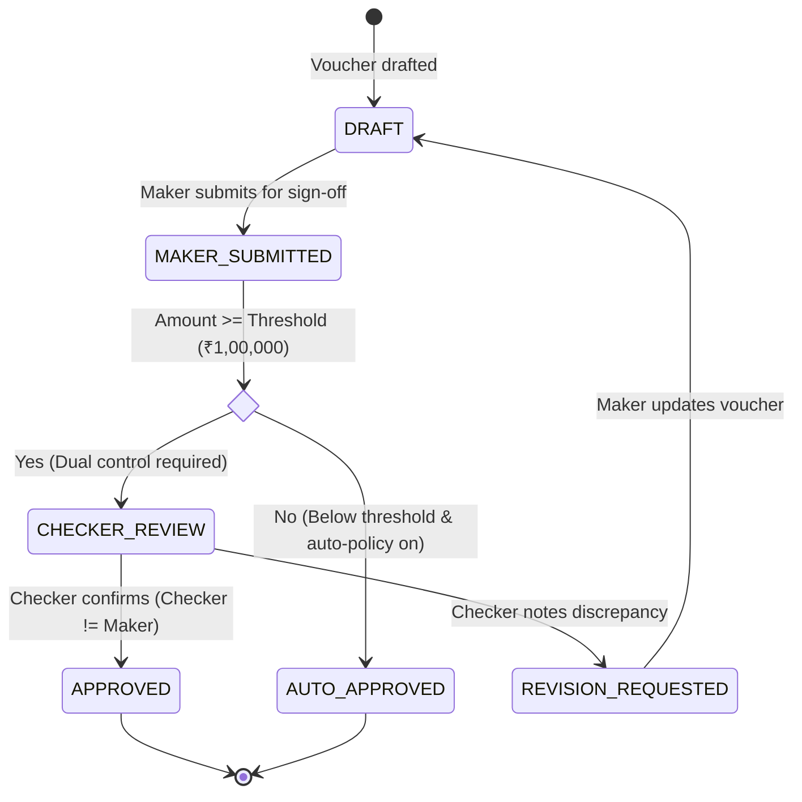

---

## 6. Security & Multi-Tenancy Architecture

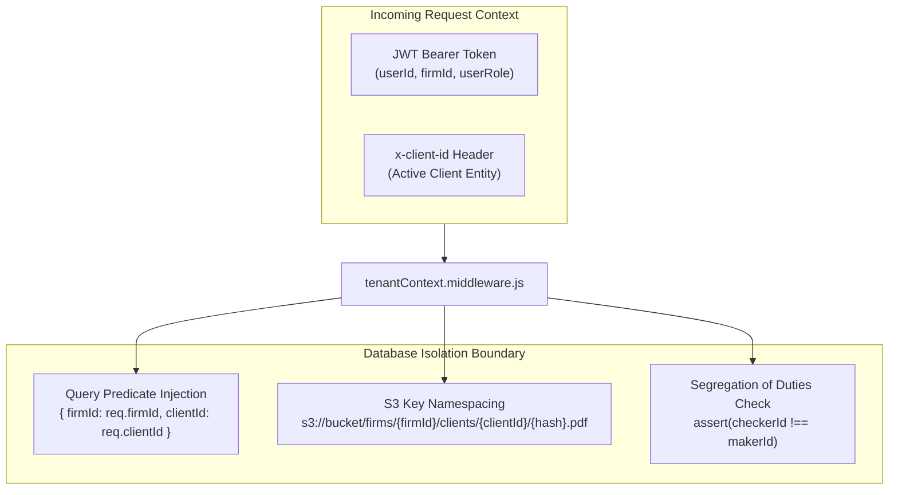

1. **Firm and Client Isolation**:
   - `firmId` defines the tenant practice (CA Firm or Business Group).
   - `clientId` defines the operating legal entity (SME client).
   - No query can execute without passing through `tenantContext.middleware.js`, which injects these filters into every MongoDB find/update and PostgreSQL query.
2. **Encrypted Storage Hierarchy**:
   - Files are stored with tenant-prefixed keys: `firms/{firmId}/clients/{clientId}/{year}/{hash}.pdf`.
   - Access is restricted exclusively to short-lived (15-minute) AWS S3 pre-signed URLs.
3. **Digital Provenance Hash Chains**:
   - Every mutation computes: $\text{Hash}_n = \text{SHA256}(\text{Hash}_{n-1} + \text{Payload} + \text{AuthorID} + \text{Timestamp})$.
   - Tampering with historical records breaks the hash verification chain immediately.

