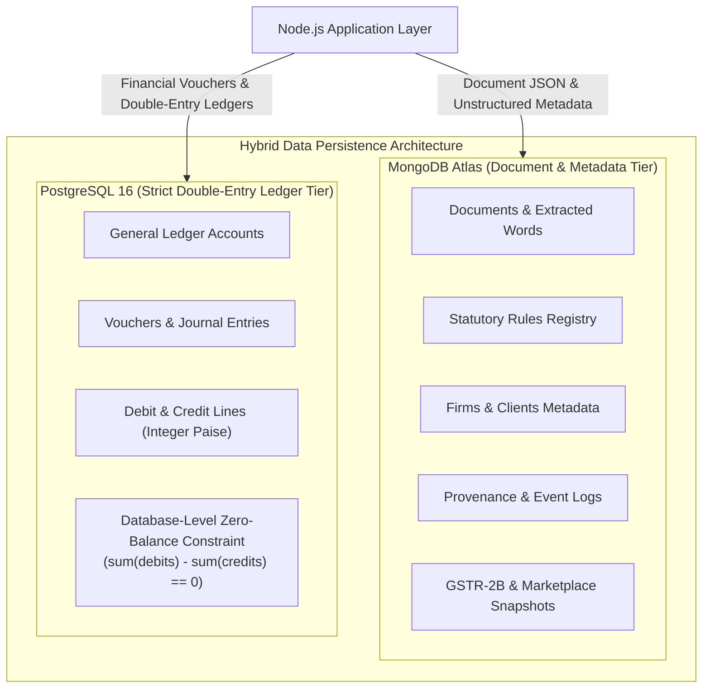
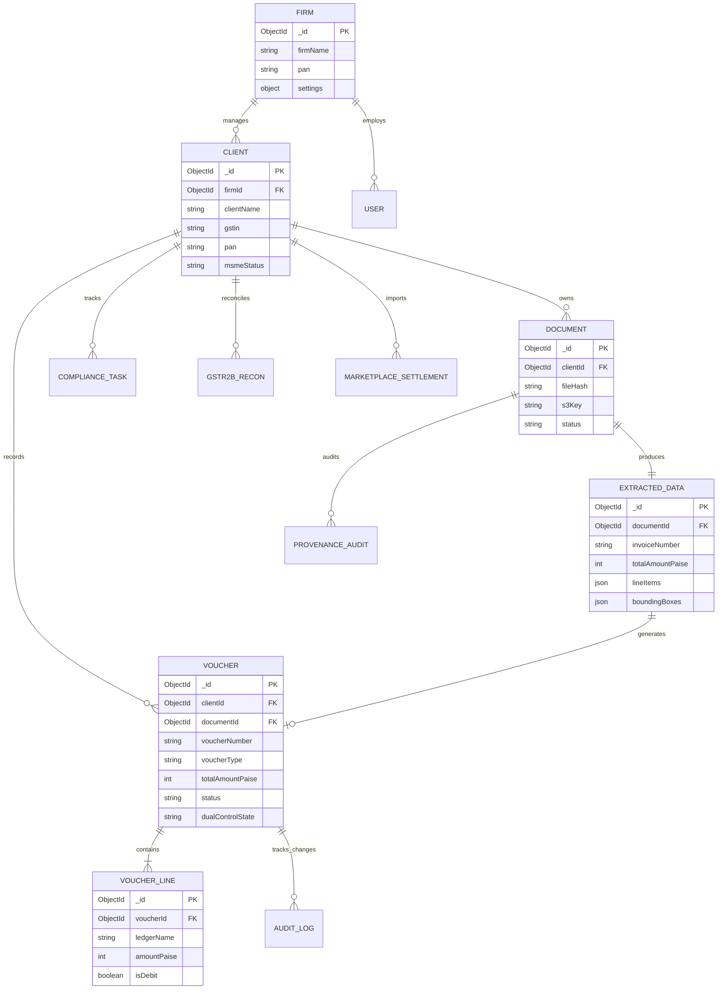

# Database Design & Schema Reference (DDS)
## Project: CKsFinBot — Autonomous Accounting & Statutory Tax Advisory Platform

---

### Document Control
- **Document ID**: DDS-CKSFINBOT-2026.1
- **Version**: 2.0.0
- **Status**: Approved & Baselined
- **Author**: Senior Full-Stack Fintech Architect

---

## 1. Database Architectural Strategy

CKsFinBot utilizes a **polyglot persistence model** tailored to data access patterns and regulatory guarantees:



1. **MongoDB (Document & Flexibility Tier)**:
   - Houses semi-structured invoice extractions, variable OCR word coordinates, PDF bounding box arrays, audit trails, and versioned rules.
2. **PostgreSQL (Strict Double-Entry Ledger Tier)**:
   - Houses the general ledger and financial journal vouchers where relational integrity, foreign keys, and database-level constraints guarantee that **unbalanced entries cannot be persisted under any circumstance**.

---

## 2. Entity-Relationship (ER) Diagram



---

## 3. MongoDB Schemas (Mongoose Models)

### 3.1 Document Model (`document.model.js`)
Stores raw document metadata, S3 storage keys, cryptographic hashes, and processing states:

```javascript
const documentSchema = new mongoose.Schema({
  firmId: { type: mongoose.Schema.Types.ObjectId, ref: "Firm", required: true, index: true },
  clientId: { type: mongoose.Schema.Types.ObjectId, ref: "Client", required: true, index: true },
  fileName: { type: String, required: true },
  fileHash: { type: String, required: true, index: true }, // SHA-256 for idempotency
  fileSize: { type: Number, required: true },
  mimeType: { type: String, required: true },
  s3Key: { type: String, required: true },
  documentCategory: {
    type: String,
    enum: ["Purchase_Invoice", "Sales_Invoice", "Expense_Bill", "Bank_Statement", "Tax_Challan", "Other"],
    default: "Purchase_Invoice",
  },
  status: {
    type: String,
    enum: ["Uploaded", "Queued", "Extracting", "Extracted", "Reviewed", "Approved", "Failed"],
    default: "Uploaded",
    index: true,
  },
  sourceChannel: { type: String, enum: ["Web_Upload", "Client_Portal", "WhatsApp_Webhook", "Email_Intake"], default: "Web_Upload" },
  pageCount: { type: Number, default: 1 },
  errorMessage: { type: String },
}, { timestamps: true });

// Compound index for tenant-scoped idempotency
documentSchema.index({ firmId: 1, clientId: 1, fileHash: 1 }, { unique: true });
```

### 3.2 Extracted Data Model (`extractedData.model.js`)
Captures verbatim raw text, word IDs, normalized values, and bounding box coordinates for click-to-source:

```javascript
const extractedDataSchema = new mongoose.Schema({
  documentId: { type: mongoose.Schema.Types.ObjectId, ref: "Document", required: true, unique: true },
  firmId: { type: mongoose.Schema.Types.ObjectId, ref: "Firm", required: true },
  clientId: { type: mongoose.Schema.Types.ObjectId, ref: "Client", required: true },
  extractorVersion: { type: String, default: "2026.1" },
  modelVersion: { type: String, default: "gemini-1.5-flash" },

  // Extracted Fields by Reference
  supplier: {
    name: { raw: String, normalized: String, bbox: [Number], page: Number, located: Boolean },
    gstin: { raw: String, normalized: String, bbox: [Number], page: Number, located: Boolean, checksumValid: Boolean },
    pan: { raw: String, normalized: String, bbox: [Number], page: Number, located: Boolean },
    address: { raw: String, bbox: [Number], page: Number },
  },
  invoice: {
    number: { raw: String, normalized: String, bbox: [Number], page: Number, located: Boolean },
    date: { raw: String, normalized: Date, bbox: [Number], page: Number, located: Boolean },
    dueDate: { raw: String, normalized: Date, bbox: [Number], page: Number },
    placeOfSupply: { stateCode: String, stateName: String, isInterState: Boolean },
  },
  financials: {
    taxableAmountPaise: { type: Number, required: true }, // Integer paise
    cgstAmountPaise: { type: Number, default: 0 },
    sgstAmountPaise: { type: Number, default: 0 },
    igstAmountPaise: { type: Number, default: 0 },
    totalTaxPaise: { type: Number, default: 0 },
    roundOffPaise: { type: Number, default: 0 },
    totalAmountPaise: { type: Number, required: true }, // Integer paise
    currency: { type: String, default: "INR" },
  },
  lineItems: [{
    description: String,
    hsnSac: String,
    quantity: Number,
    ratePaise: Number,
    taxableAmountPaise: Number,
    gstRateBps: Number, // Basis points (1800 = 18.00%)
    cgstPaise: Number,
    sgstPaise: Number,
    igstPaise: Number,
    totalPaise: Number,
    bbox: [Number],
    page: Number,
    located: Boolean,
  }],
  validationResults: [{
    ruleId: String,
    ruleVersion: String,
    ruleName: String,
    status: { type: String, enum: ["PASS", "FAIL", "WARNING", "NOT_CHECKED"] },
    reason: String,
  }],
}, { timestamps: true });
```

### 3.3 Voucher Model (`voucher.model.js`)
Represents the double-entry accounting transaction ready for ERP synchronization:

```javascript
const voucherSchema = new mongoose.Schema({
  firmId: { type: mongoose.Schema.Types.ObjectId, ref: "Firm", required: true, index: true },
  clientId: { type: mongoose.Schema.Types.ObjectId, ref: "Client", required: true, index: true },
  documentId: { type: mongoose.Schema.Types.ObjectId, ref: "Document" },
  voucherNumber: { type: String, required: true },
  voucherDate: { type: Date, required: true },
  voucherType: {
    type: String,
    enum: ["Purchase", "Sales", "Payment", "Receipt", "Journal", "Debit_Note", "Credit_Note"],
    required: true,
  },
  totalAmountPaise: { type: Number, required: true },
  lines: [{
    ledgerId: { type: mongoose.Schema.Types.ObjectId, ref: "LedgerAccount" },
    ledgerName: { type: String, required: true },
    amountPaise: { type: Number, required: true },
    isDebit: { type: Boolean, required: true },
    description: String,
    hsnSac: String,
  }],
  // Maker-Checker Dual-Control State
  dualControlState: {
    type: String,
    enum: ["NOT_REQUIRED", "PENDING_APPROVAL", "APPROVED", "REJECTED"],
    default: "NOT_REQUIRED",
  },
  makerUserId: { type: mongoose.Schema.Types.ObjectId, ref: "User" },
  checkerUserId: { type: mongoose.Schema.Types.ObjectId, ref: "User" },
  approvedAt: Date,
  status: {
    type: String,
    enum: ["Draft", "Pending_Approval", "Approved", "Exported_To_Tally", "Rejected"],
    default: "Draft",
    index: true,
  },
  msmeMetadata: {
    isMsme: Boolean,
    udyamNumber: String,
    statutoryDueDate: Date,
    daysAllowed: Number,
  },
}, { timestamps: true });

// Strict double-entry invariant verification hook
voucherSchema.pre("save", function (next) {
  let debits = 0;
  let credits = 0;
  for (const line of this.lines) {
    if (line.isDebit) debits += line.amountPaise;
    else credits += line.amountPaise;
  }
  if (debits !== credits) {
    return next(new Error(`Double-entry balance violation: Debits (${debits}) != Credits (${credits})`));
  }
  next();
});
```

---

## 4. PostgreSQL Double-Entry Ledger Schema (`schema.sql`)

PostgreSQL provides hardware-level ACID transactions and database constraints so that unbalanced ledger entries can **never** be inserted, even if application logic were bypassed.

```sql
-- PostgreSQL Strict Double-Entry Schema
CREATE EXTENSION IF NOT EXISTS "uuid-ossp";

-- Tenants (Firms)
CREATE TABLE firms (
    firm_id UUID PRIMARY KEY DEFAULT uuid_generate_v4(),
    firm_name VARCHAR(255) NOT NULL,
    created_at TIMESTAMP WITH TIME ZONE DEFAULT CURRENT_TIMESTAMP
);

-- Client Workspaces
CREATE TABLE clients (
    client_id UUID PRIMARY KEY DEFAULT uuid_generate_v4(),
    firm_id UUID NOT NULL REFERENCES firms(firm_id) ON DELETE RESTRICT,
    client_name VARCHAR(255) NOT NULL,
    gstin VARCHAR(15),
    created_at TIMESTAMP WITH TIME ZONE DEFAULT CURRENT_TIMESTAMP
);

-- General Ledger Chart of Accounts
CREATE TABLE general_ledger_accounts (
    account_id UUID PRIMARY KEY DEFAULT uuid_generate_v4(),
    firm_id UUID NOT NULL REFERENCES firms(firm_id),
    client_id UUID NOT NULL REFERENCES clients(client_id),
    account_name VARCHAR(255) NOT NULL,
    account_group VARCHAR(100) NOT NULL, -- Current Assets, Sundry Creditors, Indirect Expenses, etc.
    is_active BOOLEAN DEFAULT TRUE,
    created_at TIMESTAMP WITH TIME ZONE DEFAULT CURRENT_TIMESTAMP,
    CONSTRAINT uq_client_account UNIQUE (client_id, account_name)
);

-- Journal Vouchers
CREATE TABLE financial_vouchers (
    voucher_id UUID PRIMARY KEY DEFAULT uuid_generate_v4(),
    firm_id UUID NOT NULL REFERENCES firms(firm_id),
    client_id UUID NOT NULL REFERENCES clients(client_id),
    document_ref_id VARCHAR(64),
    voucher_number VARCHAR(100) NOT NULL,
    voucher_date DATE NOT NULL,
    voucher_type VARCHAR(50) NOT NULL,
    total_amount_paise BIGINT NOT NULL CHECK (total_amount_paise >= 0),
    is_posted BOOLEAN DEFAULT FALSE,
    posted_at TIMESTAMP WITH TIME ZONE,
    created_at TIMESTAMP WITH TIME ZONE DEFAULT CURRENT_TIMESTAMP,
    CONSTRAINT uq_client_voucher UNIQUE (client_id, voucher_number, voucher_type)
);

-- Voucher Lines (Debit / Credit)
CREATE TABLE voucher_lines (
    line_id UUID PRIMARY KEY DEFAULT uuid_generate_v4(),
    voucher_id UUID NOT NULL REFERENCES financial_vouchers(voucher_id) ON DELETE CASCADE,
    account_id UUID NOT NULL REFERENCES general_ledger_accounts(account_id),
    amount_paise BIGINT NOT NULL CHECK (amount_paise > 0),
    is_debit BOOLEAN NOT NULL,
    narration TEXT,
    created_at TIMESTAMP WITH TIME ZONE DEFAULT CURRENT_TIMESTAMP
);

-- DATABASE-LEVEL TRIGGER: Guarantees Debits == Credits upon Voucher Commit
CREATE OR REPLACE FUNCTION verify_voucher_double_entry_balance()
RETURNS TRIGGER AS $$
DECLARE
    v_debit_sum BIGINT;
    v_credit_sum BIGINT;
BEGIN
    SELECT 
        COALESCE(SUM(CASE WHEN is_debit THEN amount_paise ELSE 0 END), 0),
        COALESCE(SUM(CASE WHEN NOT is_debit THEN amount_paise ELSE 0 END), 0)
    INTO v_debit_sum, v_credit_sum
    FROM voucher_lines
    WHERE voucher_id = NEW.voucher_id;

    IF v_debit_sum <> v_credit_sum THEN
        RAISE EXCEPTION 'DB Invariant Violation: Unbalanced Voucher %. Debits (%) != Credits (%)',
            NEW.voucher_id, v_debit_sum, v_credit_sum;
    END IF;

    RETURN NEW;
END;
$$ LANGUAGE plpgsql;

-- Constraint Trigger executed at transaction commit time
CREATE CONSTRAINT TRIGGER trg_enforce_voucher_balance
AFTER INSERT OR UPDATE ON financial_vouchers
DEFERRABLE INITIALLY DEFERRED
FOR EACH ROW
EXECUTE FUNCTION verify_voucher_double_entry_balance();
```

---

## 5. Data Retention & DPDP Cryptographic Shredding

1. **Statutory Retention**: Under Section 36 of the CGST Act and Section 44AB of the Income-tax Act, books of account must be retained for **72 months (6 years)** from the due date of filing the annual return.
2. **Right to Erasure (DPDP Act 2023)**:
   - When a client exercises deletion rights, personal identifiers (names, phone numbers, email addresses) are cryptographically shredded.
   - Financial audit numbers and voucher hashes are anonymized and preserved for statutory audit integrity.
   - S3 objects are purged via AWS lifecycle policies following an automated deletion manifest.

