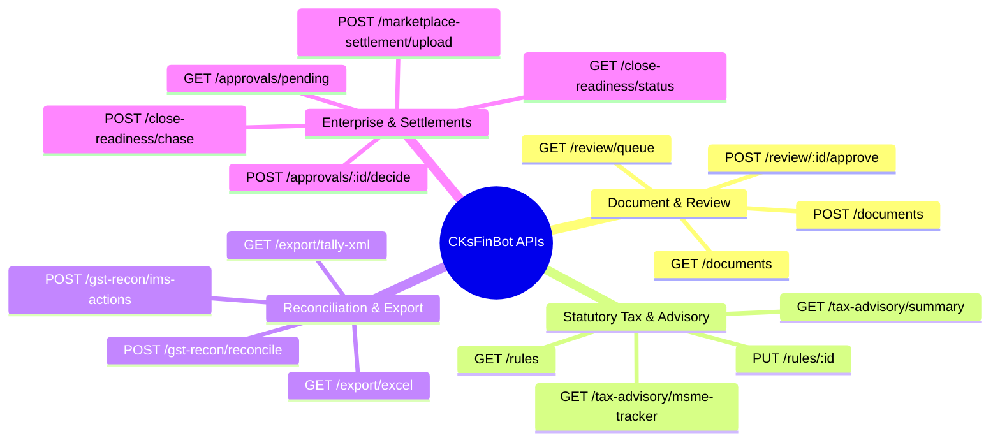

# API Specification Reference (REST & Microservices)
## Project: CKsFinBot — Autonomous Accounting & Statutory Tax Advisory Platform

---

### Document Control
- **Document ID**: API-CKSFINBOT-2026.1
- **Version**: 2.0.0
- **Base URL**: `http://localhost:8000/api/v1` (Node.js) / `http://localhost:8001/api` (Python AI)
- **Protocol**: HTTPS / REST / JSON
- **Authentication**: JWT Bearer Token + Multi-Tenant Context Headers

---

## 1. Global Request & Response Conventions

### 1.1 Required Headers

| Header | Description | Required | Example |
| :--- | :--- | :--- | :--- |
| `Authorization` | Bearer JWT containing authenticated user identity | Yes | `Bearer eyJhbGciOiJIUzI1Ni...` |
| `x-firm-id` | Operating CA Firm or Enterprise Tenant ID | Yes | `672e811f0a12e9b04859a101` |
| `x-client-id` | Selected Client Business Workspace ID | Yes (for client routes) | `672e811f0a12e9b04859a102` |
| `Content-Type` | Payload serialization format | Yes | `application/json` or `multipart/form-data` |

### 1.2 Standard Success Envelope
```json
{
  "success": true,
  "statusCode": 200,
  "data": { ... },
  "message": "Operation completed successfully",
  "timestamp": "2026-11-13T18:15:00.000Z"
}
```

### 1.3 Standard Error Envelope
```json
{
  "success": false,
  "statusCode": 400,
  "message": "Double-entry balance violation: Debits (125000) != Credits (120000)",
  "error": {
    "code": "DOUBLE_ENTRY_UNBALANCED",
    "details": [
      { "field": "lines", "issue": "Conservation check failed by 5000 paise" }
    ]
  },
  "timestamp": "2026-11-13T18:15:00.000Z"
}
```

---

## 2. API Endpoints Catalog



---

## 3. Detailed Endpoint Specifications

### 3.1 Document Ingestion & Queue Pipeline

#### `POST /documents/upload`
Uploads a document file or registers an S3 upload.

- **Content-Type**: `multipart/form-data`
- **Request Body**:
  - `file`: Binary file (PDF, PNG, JPG, XLSX).
  - `documentCategory`: `Purchase_Invoice` | `Expense_Bill` | `Bank_Statement`.
- **Response `202 Accepted`**:
```json
{
  "success": true,
  "statusCode": 202,
  "data": {
    "documentId": "6731e0b501d51a2e38b001a1",
    "fileHash": "9f86d081884c7d659a2feaa0c55ad015a3bf4f1b2b0b822cd15d6c15b0f00a08",
    "status": "Queued",
    "jobId": "bullmq:extract:10492"
  },
  "message": "Document scheduled for text-layer extraction and deterministic verification"
}
```

#### `GET /documents`
Lists documents for the active client workspace with pagination and status filtering.

- **Query Parameters**:
  - `page`: default `1`
  - `limit`: default `20`
  - `status`: `Uploaded` | `Queued` | `Extracted` | `Reviewed` | `Approved` | `Failed`
  - `category`: `Purchase_Invoice` | `Bank_Statement`

---

### 3.2 Click-to-Source & Review Queue

#### `GET /review/queue`
Retrieves pending extracted vouchers requiring human verification.

- **Response `200 OK`**:
```json
{
  "success": true,
  "data": [
    {
      "voucherId": "6731e21b01d51a2e38b00201",
      "documentId": "6731e0b501d51a2e38b001a1",
      "fileName": "Steel_Invoice_884.pdf",
      "invoiceNumber": "INV/2026/884",
      "invoiceDate": "2026-05-14",
      "supplierName": "Tata Steel Limited",
      "supplierGstin": "27AAACT2727Q1ZW",
      "totalAmountPaise": 23600000,
      "validationStatus": "WARNING",
      "hasUnlocatedFields": false,
      "flagsCount": 1
    }
  ]
}
```

#### `GET /review/:documentId/evidence`
Retrieves extracted word tokens, bounding boxes, and document viewer coordinates.

- **Response `200 OK`**:
```json
{
  "success": true,
  "data": {
    "documentUrl": "https://s3.ap-south-1.amazonaws.com/bucket/firms/.../file.pdf?AWSAccessKeyId=...",
    "pageCount": 2,
    "fields": {
      "invoiceNumber": { "value": "INV/2026/884", "bbox": [120, 80, 240, 95], "page": 1, "located": true },
      "totalAmount": { "value": "2,36,000.00", "paise": 23600000, "bbox": [420, 560, 520, 580], "page": 1, "located": true },
      "gstin": { "value": "27AAACT2727Q1ZW", "bbox": [120, 100, 260, 115], "page": 1, "located": true }
    },
    "validationInvariants": [
      { "ruleId": "VAL-GSTIN-001", "name": "GSTIN Checksum", "status": "PASS", "reason": "Checksum character W matches MOD 36-2" },
      { "ruleId": "VAL-TAX-002", "name": "Tax Split", "status": "PASS", "reason": "Inter-state supply: 100% IGST applied" }
    ]
  }
}
```

---

### 3.3 GSTR-2B 2-Tier Reconciliation & IMS

#### `POST /gst-recon/reconcile`
Uploads GSTR-2B JSON/Excel and runs 2-tier matching against posted purchase vouchers.

- **Request Body**: `multipart/form-data` with `file` and `returnPeriod` (e.g. `042026`).
- **Response `200 OK`**:
```json
{
  "success": true,
  "data": {
    "summary": {
      "totalPurchaseBooksPaise": 154000000,
      "totalGstr2bPaise": 152000000,
      "exactMatchCount": 42,
      "exactMatchPaise": 142000000,
      "fuzzyMatchCount": 3,
      "fuzzyMatchPaise": 5000000,
      "missingIn2bCount": 4,
      "itcAtRiskPaise": 1260000,
      "conservationVerified": true
    },
    "fuzzyCandidates": [
      {
        "booksVoucherId": "6731e21b01d51a2e38b00201",
        "portalInvoiceId": "2B-INV-9912",
        "similarityScore": 0.94,
        "matchReason": "Invoice number normalized (INV-884 == INV884) with amount tolerance ₹0.50",
        "status": "Awaiting_CA_Confirmation"
      }
    ]
  }
}
```

#### `POST /gst-recon/ims-actions`
Submits bulk Invoice Management System (IMS) decisions.

- **Request Body**:
```json
{
  "actions": [
    { "invoiceId": "2B-INV-9912", "action": "Accept", "remarks": "Confirmed with delivery challan" },
    { "invoiceId": "2B-INV-9913", "action": "Reject", "remarks": "Order cancelled; duplicate filing" },
    { "invoiceId": "2B-INV-9914", "action": "Pending", "remarks": "Goods in transit" }
  ]
}
```

---

### 3.4 TallyPrime XML Double-Entry Export

#### `GET /export/tally-xml`
Generates and downloads double-entry balanced TallyPrime XML.

- **Query Parameters**:
  - `startDate`: `2026-04-01`
  - `endDate`: `2026-04-30`
  - `voucherTypes`: `Purchase,Journal`
- **Response `200 OK`**:
  - `Content-Type`: `application/xml`
  - `Content-Disposition`: `attachment; filename="Tally_Vouchers_20260401_20260430.xml"`
  - Body: Tally XML containing `<ENVELOPE>` with balanced polarity `<ALLLEDGERENTRIES.LIST>`.

---

### 3.5 Statutory Tax Advisory & MSME Section 43B(h)

#### `GET /tax-advisory/summary`
Evaluates Section 40(a)(ia) TDS, Section 40A(3) cash limits, and Section 43B(h) MSME overdue risk.

- **Response `200 OK`**:
```json
{
  "success": true,
  "data": {
    "metrics": {
      "totalPotentialDisallowance": 450000.00,
      "sec40AiaTdsDisallowance": 120000.00,
      "sec40A3CashDisallowance": 45000.00,
      "sec43BhMsmeDisallowance": 285000.00
    },
    "flaggedVouchers": [
      {
        "voucherNumber": "PUR/2026/041",
        "voucherDate": "2026-04-18",
        "amount": 400000.00,
        "flags": [
          {
            "section": "Section 194C / 40(a)(ia)",
            "severity": "Danger",
            "potentialDisallowance": 120000.00,
            "message": "Payment to contractor exceeds ₹1,00,000 without TDS deduction.",
            "suggestedAction": "Deduct 1% TDS (₹4,000) or obtain Form 15G/15H declaration before year end."
          }
        ]
      }
    ]
  }
}
```

#### `GET /tax-advisory/msme-tracker`
Lists all vendor bills tagged with Micro or Small enterprise classification.

- **Response `200 OK`**:
```json
{
  "success": true,
  "data": {
    "metrics": {
      "totalMsmeBills": 14,
      "totalMsmeOutstanding": 1850000.00,
      "totalDisallowedUnder43Bh": 285000.00,
      "totalDueWithin7Days": 95000.00
    },
    "bills": [
      {
        "voucherId": "6731e0b501d51a2e38b00999",
        "vendorName": "Apex Precision Tooling",
        "msmeCategory": "Small",
        "msmeUdyamNumber": "UDYAM-GJ-01-0029141",
        "voucherNumber": "INV-1092",
        "voucherDate": "2026-02-10",
        "amount": 285000.00,
        "statutoryDueDate": "2026-03-27",
        "daysRemaining": -48,
        "status": "Disallowed_43Bh"
      }
    ]
  }
}
```

---

### 3.6 Month-End Close Readiness & WhatsApp Chasing

#### `GET /close-readiness/status`
Returns the 5-pillar close readiness assessment.

- **Response `200 OK`**:
```json
{
  "success": true,
  "data": {
    "readinessScore": 84,
    "state": "Near Complete",
    "pillars": {
      "bankReconciliation": { "score": 25, "weight": 25, "gaps": 0 },
      "gstr2bMatching": { "score": 21, "weight": 25, "gaps": 2 },
      "expenseApprovals": { "score": 18, "weight": 20, "gaps": 3 },
      "taxCompliance": { "score": 10, "weight": 15, "gaps": 1 },
      "msme45DayStatus": { "score": 10, "weight": 15, "gaps": 1 }
    },
    "missingRecurringDocuments": [
      { "category": "Internet / Broadband", "vendor": "Airtel Enterprise", "expectedMonth": "April 2026" }
    ]
  }
}
```

#### `POST /close-readiness/chase`
Dispatches an automated WhatsApp or Email follow-up to the client SME with magic upload link.

- **Request Body**:
```json
{
  "channel": "WhatsApp",
  "recipientPhone": "+919876543210",
  "missingItems": ["Airtel Broadband - April 2026", "HDFC Bank Statement - April 2026"]
}
```

---

### 3.7 E-Commerce Marketplace Settlement

#### `POST /marketplace-settlement/upload`
Uploads and decomposes Amazon MTR / Settlement flat-files or Flipkart GSTR-8 statements.

- **Request Body**: `multipart/form-data` with `file` and `marketplace` (`Amazon` | `Flipkart`).
- **Response `200 OK`**:
```json
{
  "success": true,
  "data": {
    "settlementId": "SETTLE-AMZN-2026-04-15",
    "decomposition": {
      "grossSalesPaise": 54200000,
      "customerReturnsPaise": 4800000,
      "commissionFeesPaise": 6500000,
      "fbaShippingFeesPaise": 4200000,
      "tcsUnderSec52Paise": 494000,
      "tdsUnderSec194OPaise": 494000,
      "netBankDepositPaise": 37712000
    },
    "balancedVoucherGenerated": true
  }
}
```

---

### 3.8 Python AI Microservice Internal RPCs

#### `POST http://localhost:8001/api/extract/v2`
Performs word-coordinate extraction and LLM schema mapping.

- **Request Body**:
```json
{
  "documentUrl": "https://s3.ap-south-1.amazonaws.com/...",
  "mimeType": "application/pdf",
  "extractByReference": true
}
```
- **Response `200 OK`**:
  Returns array of page geometry, word bounding boxes, recognized table tokens, and structured field bindings.

