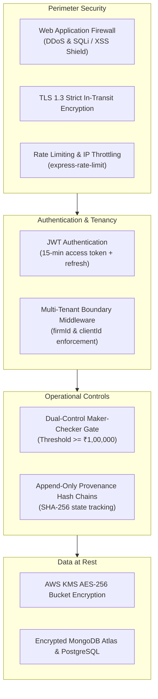
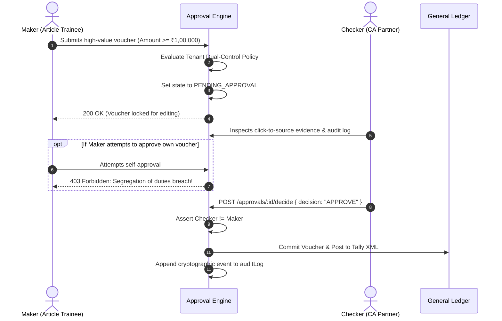
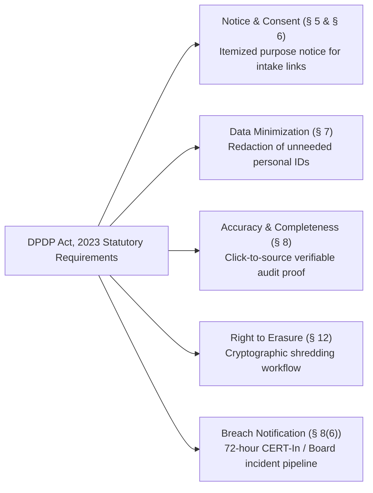

# Security, Governance & DPDP Act Compliance Guide
## Project: CKsFinBot — Autonomous Accounting & Statutory Tax Advisory Platform

---

### Document Control
- **Document ID**: SEC-CKSFINBOT-2026.1
- **Version**: 2.0.0
- **Status**: Approved & Baselined
- **Author**: Senior Full-Stack Fintech Architect & Data Protection Officer (DPO)

---

## 1. Security Architecture & Threat Model

Financial accounting platforms handle confidential bank statements, tax IDs (PAN, GSTIN), trade terms, and pricing secrets. CKsFinBot is engineered around zero-trust and defense-in-depth principles:



---

## 2. Multi-Tenancy Isolation Model

1. **Logical Partitioning**:
   - Every database document (MongoDB) and relational row (PostgreSQL) is strictly bound to a `firmId` (Accounting Practice / Enterprise Tenant) and `clientId` (Operating SME Entity).
   - The application middleware [`tenantContext.middleware.js`](file:///d:/WORK/Project/CKsFinBot/Node-Backend/src/Middlewares/tenantContext.middleware.js) intercepts every request, validates JWT claims against requested workspace IDs, and injects mandatory filters into the database driver.
2. **S3 Storage Namespacing**:
   - Documents are stored in isolated prefix hierarchies:
     ```
     s3://cksfinbot-vault/firms/{firmId}/clients/{clientId}/{financialYear}/{fileHash}.pdf
     ```
   - Direct access is completely blocked. Clients interact solely via AWS S3 pre-signed URLs with a maximum expiration time of **900 seconds (15 minutes)**.

---

## 3. Dual-Control Maker-Checker Gate

To eliminate rogue entries, employee embezzlement, and unilateral erroneous postings, CKsFinBot implements a strict dual-control policy:



### Maker-Checker Invariants:
1. **Segregation of Duties**: A user CANNOT act as Checker on any voucher where they are the Maker (`makerUserId !== checkerUserId`).
2. **Configurable Thresholds**: Practice partners configure monetary thresholds per client workspace (e.g., ₹50,000 for high-risk entities, ₹2,00,000 for standard clients).
3. **Emergency Override**: In critical close windows, an emergency override requires multi-factor authentication (MFA) and generates a high-severity alert in the compliance dashboard.

---

## 4. India Digital Personal Data Protection (DPDP) Act, 2023 Alignment



### 4.1 Notice and Consent (§ 5 & § 6)
- When generating magic intake links or receiving documents via WhatsApp, clients are presented with a clear, itemized bilingual (English/Hindi) consent banner explaining that submitted financial documents will be parsed for bookkeeping, statutory reconciliation, and tax audit compliance.
- Consent records are logged with IP address, timestamp, and identity reference.

### 4.2 Data Minimization & Security Safeguards (§ 7 & § 8)
- Personal identity documents (Aadhaar cards, personal photos) submitted inadvertently are identified by AI classification, quarantined, and excluded from ledger extraction.
- Cryptographic keys are rotated every 90 days in compliance with statutory guidance.

### 4.3 Data Principal Rights: Erasure & Cryptographic Shredding (§ 12)
- Upon receiving a formal erasure request from an enterprise client:
  1. All personal identifiers (contact names, email IDs, phone numbers) are overwritten with one-way pseudonymous hashes.
  2. S3 source binaries are permanently purged.
  3. Historical accounting amounts and tax voucher totals are anonymized and retained in integer paise to satisfy the mandatory 6-year books retention requirement under Section 44AB of the Income-tax Act.

### 4.4 Breach Management Protocol
- In the event of a suspected exfiltration or security incident, the system triggers the automated incident runbook:
  - Invalidate all active JWT tokens and revoke S3 pre-signed URLs.
  - Snapshot the immutable audit logs.
  - Deliver automated breach notification to the Data Protection Board of India and affected data fiduciaries within 72 hours.

---

## 5. STRIDE Threat Analysis Matrix

| Threat Category | Potential Attack Vector | Platform Mitigation Control |
| :--- | :--- | :--- |
| **Spoofing** | Forged JWT token or fake tenant headers | Asymmetric RSA/HMAC-SHA256 signature verification; cross-checks user claims with active database session. |
| **Tampering** | Modifying approved voucher amounts directly in DB | Immutable append-only audit log; digital hash chain ($\text{SHA-256}$) breaks if past rows are mutated; PostgreSQL DB-level constraints. |
| **Repudiation** | User denies altering an extracted invoice number | Word-level provenance recorded with user ID, IP address, exact coordinate box, and timestamp. |
| **Information Disclosure** | Cross-tenant document URL leakage | S3 presigned URLs expire in 15 minutes; URL generation validates active `firmId` and `clientId` context. |
| **Denial of Service** | Bombardment with 500-page corrupted PDFs | BullMQ queue with per-tenant concurrency limits; PDF pre-flight checks file size (<50MB) and page count before worker dispatch. |
| **Elevation of Privilege** | Article trainee executing dual-control approvals | Strict Role-Based Access Control (RBAC): `Firm_Admin`, `CA_Partner`, `Senior_Reviewer`, `Article_Trainee`, `Client_Viewer`. |

