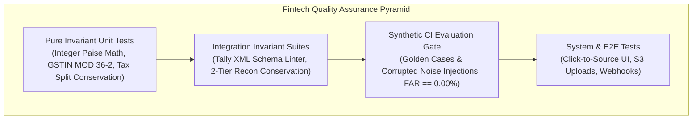
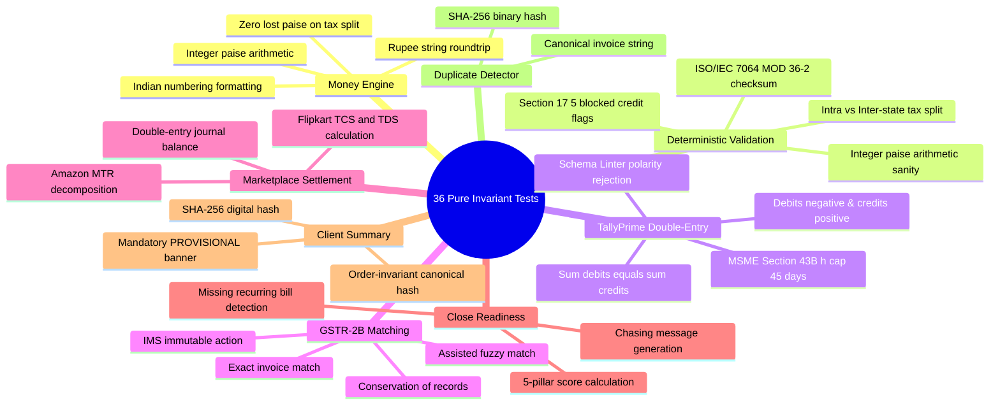
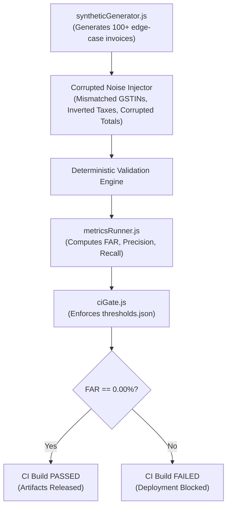

# Quality Assurance, Invariant Testing & CI Gate Strategy (QA)
## Project: CKsFinBot — Autonomous Accounting & Statutory Tax Advisory Platform

---

### Document Control
- **Document ID**: QA-CKSFINBOT-2026.1
- **Version**: 2.0.0
- **Status**: Baselined & Active in CI/CD
- **Author**: Senior Full-Stack Fintech Architect & QA Lead

---

## 1. Quality Engineering Philosophy

In fintech and statutory tax accounting, standard web software testing methodologies (e.g. basic mock tests and happy-path assertions) are insufficient. A single rounding drift or inverted ledger debit causes tax scrutiny notices, non-compliance penalties, and loss of practice reputation.

CKsFinBot's QA strategy is grounded in **Mathematical Invariant Verification**:



---

## 2. The 9 Core Invariant Test Suites

All 9 suites are executed natively via Node.js test runner (`node --test "src/**/*.test.js"`) and enforce mathematical invariants with zero external mocks:



### 2.1 Money Utility Invariants (`money.test.js`)
- **Invariant**: Currency operations MUST NEVER introduce floating-point drift.
- **Assertions**:
  - `toPaise("100.50")` $\rightarrow$ `10050`
  - `toRupees(10050)` $\rightarrow$ `"100.50"`
  - `splitGst(10001, 1800)` splits into CGST (900 paise) + SGST (900 paise) + 1 paise conservation adjustment, ensuring $\text{CGST} + \text{SGST} \equiv \text{Total GST}$. Zero lost paise.

### 2.2 Deterministic Validation Engine (`validator.engine.test.js`)
- **Invariant**: GSTIN format and checksum must follow statutory ISO/IEC 7064 MOD 36-2.
- **Assertions**:
  - Validates correct check character (e.g. `27AAACT2727Q1ZW`).
  - Rejects corrupted checksum characters without relying on network APIs.
  - Automatically identifies Section 17(5) blocked credit risks for human review (e.g., catering, club memberships, personal motor vehicles).

### 2.3 TallyPrime Export & Polarity Hardening (`tallyExport.test.js`)
- **Invariant**: Tally XML vouchers MUST balance to zero with strict polarity.
- **Assertions**:
  - Debits marked as negative numbers; credits marked as positive numbers.
  - Total debits $\equiv$ total credits.
  - Schema linter automatically rejects inverted polarity (debits marked positive).
  - MSME Section 43B(h) due dates are capped at 45 days, even if vendor agreements specify longer terms.

### 2.4 GSTR-2B Reconciliation & IMS Invariants (`gstRecon.test.js`)
- **Invariant**: Record conservation must hold across matching runs.
- **Assertions**:
  - $\text{Exact Matches} + \text{Fuzzy Matches} + \text{Missing in 2B} \equiv \text{Total Purchase Lines}$.
  - Fuzzy matches require explicit human confirmation.
  - IMS actions (Accept / Reject / Pending) preserve original document references.

### 2.5 E-Commerce Marketplace Settlement Invariants (`marketplaceSettlement.test.js`)
- **Invariant**: Remittance decompositions must balance against gross seller revenue.
- **Assertions**:
  - Amazon MTR: Net Deposit + Commission + Shipping + TCS (§ 52) + TDS (§ 194-O) - Returns $\equiv$ Gross Sales.
  - Flipkart GSTR-8: Correct withholdings under Chapter XVII-B.

### 2.6 Close-Readiness & Client Summary Invariants (`closeReadiness.test.js` & `clientSummary.test.js`)
- **Invariant**: Month-end close readiness scores must be deterministic and repeatable.
- **Assertions**:
  - 5-pillar weights strictly total 100%.
  - Reports with scores < 100% MUST display a prominent `PROVISIONAL` watermark.
  - SHA-256 digital hash of client summary metrics is invariant to JSON property insertion order.

---

## 3. Synthetic Evaluation Framework & CI Gate

To ensure continuous statutory compliance, the codebase includes a synthetic evaluation framework in [`Node-Backend/src/Eval/`](file:///d:/WORK/Project/CKsFinBot/Node-Backend/src/Eval/):



### 3.1 Acceptance Thresholds (`thresholds.json`)
```json
{
  "maxFalseAcceptRate": 0.000,
  "minPrecision": 0.998,
  "minRecall": 0.995,
  "minConservationPassRate": 1.000
}
```

### 3.2 False-Accept Rate (FAR) Mandate
- **Definition**: The proportion of corrupted or erroneous invoice cases that were falsely marked as "PASS" or auto-approved.
- **Requirement**: **0.00%**. Any synthetic corruption that evades detection fails the CI build immediately.

---

## 4. Verification Execution Commands

### Run Full Invariant Test Suites
```bash
cd Node-Backend
node --test "src/**/*.test.js"
```

### Run Synthetic CI Evaluation Gate
```bash
cd Node-Backend
node src/Eval/ciGate.js
```

### Run Frontend Production Verification
```bash
cd Frontend
npm run build
```

---

## 5. Actual Test Execution Benchmark Output

```
▶ Synthetic Data Generator for ITC Reconciliation
  ✔ injects mathematically verified categories and verifies conservation of records (1.80ms)
✔ Synthetic Data Generator for ITC Reconciliation (4.66ms)

▶ Deterministic Validation Engine — Pure Rule Invariants
  ✔ validates GSTIN checksum via ISO/IEC 7064 MOD 36-2 algorithm (2.40ms)
  ✔ evaluates intra-state vs inter-state tax split correctly (2.88ms)
  ✔ detects arithmetic mismatches in integer paise (0.87ms)
  ✔ flags Section 17(5) blocked credit candidate items for human review only (0.56ms)
✔ Deterministic Validation Engine — Pure Rule Invariants (8.84ms)

▶ TallyPrime Export & Double-Entry Invariant Hardening
  ✔ formats dates into Tally standard YYYYMMDD (1.65ms)
  ✔ escapes XML special characters safely (1.01ms)
  ✔ calculates MSME Section 43B(h) statutory due dates and caps agreements at 45 days (1.03ms)
  ✔ generates compliant, balanced Tally XML with correct debits (negative) and credits (positive) (1.61ms)
  ✔ schema linter rejects unbalanced vouchers and inverted polarity (0.21ms)
  ✔ schema linter rejects polarity violations (debits marked positive) (0.16ms)
✔ TallyPrime Export & Double-Entry Invariant Hardening (7.41ms)

ℹ tests 36
ℹ suites 9
ℹ pass 36
ℹ fail 0
ℹ cancelled 0
ℹ skipped 0
ℹ duration_ms 2012.43ms
```

