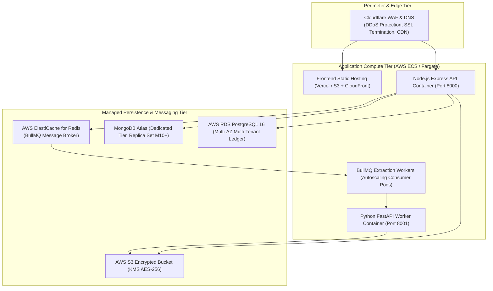
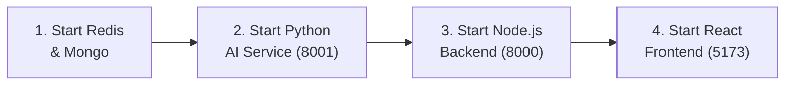

# Deployment, DevOps & Operational Runbook (DOR)
## Project: CKsFinBot — Autonomous Accounting & Statutory Tax Advisory Platform

---

### Document Control
- **Document ID**: OPS-CKSFINBOT-2026.1
- **Version**: 2.0.0
- **Status**: Approved & Baselined
- **Author**: Senior Full-Stack Fintech Architect & DevOps Lead

---

## 1. Production Infrastructure Topology

CKsFinBot deploys across a resilient, containerized multi-cloud topology:



---

## 2. Environment Variables & Configuration Matrix

### 2.1 Node.js Backend (`Node-Backend/.env`)
```ini
# Server & Environment
PORT=8000
NODE_ENV=production
FRONTEND_URL=https://app.cksfinbot.com

# MongoDB Atlas
MONGODB_URI=mongodb+srv://<user>:<password>@cluster0.mongodb.net/cksfinbot?retryWrites=true&w=majority

# PostgreSQL Double-Entry Ledger
POSTGRES_HOST=cksfinbot-rds.internal.ap-south-1.rds.amazonaws.com
POSTGRES_PORT=5432
POSTGRES_DB=cksfinbot_ledger
POSTGRES_USER=ledger_app_user
POSTGRES_PASSWORD=<secure_password>
POSTGRES_SSL=true

# Redis & BullMQ
REDIS_HOST=cksfinbot-redis.internal.cache.amazonaws.com
REDIS_PORT=6379
REDIS_PASSWORD=<redis_auth_token>

# JWT Authentication
JWT_SECRET=super_secret_jwt_signing_key_min_32_chars
JWT_EXPIRY=15m
JWT_REFRESH_SECRET=super_secret_refresh_key
JWT_REFRESH_EXPIRY=7d

# AWS S3 Storage
AWS_REGION=ap-south-1
AWS_ACCESS_KEY_ID=<aws_key_id>
AWS_SECRET_ACCESS_KEY=<aws_secret_key>
AWS_S3_BUCKET=cksfinbot-documents-vault
AWS_S3_PRESIGNED_EXPIRATION_SECONDS=900

# Python AI Service RPC
PYTHON_AI_SERVICE_URL=http://cksfinbot-ai.internal:8001
```

### 2.2 Python AI Microservice (`Python-Backend/.env`)
```ini
# Server Configuration
HOST=0.0.0.0
PORT=8001
ENVIRONMENT=production

# Google Gemini API
GEMINI_API_KEY=<google_ai_studio_api_key>
GEMINI_MODEL=gemini-1.5-flash

# AWS S3 Access
AWS_REGION=ap-south-1
AWS_ACCESS_KEY_ID=<aws_key_id>
AWS_SECRET_ACCESS_KEY=<aws_secret_key>
AWS_S3_BUCKET=cksfinbot-documents-vault

# OCR Engine
OCR_PROVIDER=tesseract # tesseract | google_vision | azure_read
```

### 2.3 React Frontend (`Frontend/.env`)
```ini
VITE_API_BASE_URL=https://api.cksfinbot.com/api/v1
VITE_APP_NAME="CKsFinBot"
VITE_APP_ENV=production
```

---

## 3. Local Development Startup Runbook

Follow these exact steps to launch the complete platform locally:



### Terminal 1: Infrastructure (Redis)
Ensure local Redis and MongoDB are running:
```bash
# Start Redis (via Docker or local daemon)
docker run -d --name cksfinbot-redis -p 6379:6379 redis:7-alpine
```

### Terminal 2: Python AI Service
```bash
cd CKsFinBot/Python-Backend
# Create & activate virtual environment
python -m venv .venv
# Windows:
.venv\Scripts\activate
# Linux/macOS: source .venv/bin/activate

# Install dependencies & start FastAPI
pip install -r requirements.txt
uvicorn app.main:app --host 0.0.0.0 --port 8001 --reload
```

### Terminal 3: Node.js Backend
```bash
cd CKsFinBot/Node-Backend
npm install
npm run dev
# Server starts on http://localhost:8000
```

### Terminal 4: Frontend Web Application
```bash
cd CKsFinBot/Frontend
npm install
npm run dev
# Web application available at http://localhost:5173
```

---

## 4. Docker Containerization Setup

### Multi-Container `docker-compose.yml`
```yaml
version: '3.8'

services:
  redis:
    image: redis:7-alpine
    container_name: cksfinbot-redis
    ports:
      - "6379:6379"
    restart: always

  python-ai:
    build:
      context: ./Python-Backend
      dockerfile: Dockerfile
    container_name: cksfinbot-ai
    ports:
      - "8001:8001"
    env_file:
      - ./Python-Backend/.env
    restart: always

  node-backend:
    build:
      context: ./Node-Backend
      dockerfile: Dockerfile
    container_name: cksfinbot-backend
    ports:
      - "8000:8000"
    env_file:
      - ./Node-Backend/.env
    depends_on:
      - redis
      - python-ai
    restart: always

  frontend:
    build:
      context: ./Frontend
      dockerfile: Dockerfile
    container_name: cksfinbot-frontend
    ports:
      - "5173:80"
    depends_on:
      - node-backend
    restart: always
```

---

## 5. Operational Incident Runbooks

### Runbook 1: Dead-Letter Queue (DLQ) Recovery
- **Trigger**: `document-extraction-dlq` metric alert triggers in CloudWatch/Datadog.
- **Symptom**: Documents remain in `Failed` state or retry count reaches 3.
- **Resolution Steps**:
  1. Inspect failed job logs using Redis CLI:
     ```bash
     redis-cli -h $REDIS_HOST HGETALL "bull:document-extraction:failed"
     ```
  2. Check error trace:
     - If `PDF_CORRUPTED`: Mark document `Unprocessable` and notify user via review inbox.
     - If `S3_TIMEOUT` or `AI_RATE_LIMIT`: Trigger bulk replay:
       ```javascript
       // Run via admin management script
       import { documentQueue } from "./src/Queues/documentExtraction.queue.js";
       await documentQueue.retryJobs({ count: 50 });
       ```

### Runbook 2: S3 Presigned URL Expiration & Refresh
- **Trigger**: Review Queue document viewer renders `403 Forbidden` on PDF render.
- **Resolution Steps**:
  1. Ensure system clocks are synchronized with NTP (`w32tm /resync` or `ntpdate`).
  2. The frontend client automatically queries `/api/v1/documents/:id/signed-url` on viewer mount, returning a fresh 15-minute presigned S3 token.

### Runbook 3: Statutory Tax Rule Registry Update
- **Trigger**: Ministry of Finance issues a new notification modifying TDS rates or Section 43B(h) applicability thresholds.
- **Resolution Steps**:
  1. Navigate to [`Node-Backend/src/Rules/registry.json`](file:///d:/WORK/Project/CKsFinBot/Node-Backend/src/Rules/registry.json).
  2. Add a new rule revision entry:
     ```json
     {
       "ruleId": "RULE-TDS-194C-2026.2",
       "description": "Amended Section 194C threshold",
       "effectiveFrom": "2026-10-01",
       "effectiveTo": null,
       "officialSourceUrl": "https://incometaxindia.gov.in/notifications/...",
       "status": "verified",
       "reviewedBy": "Senior CA Partner",
       "reviewDate": "2026-09-28"
     }
     ```
  3. Run pure invariant tests to ensure no regressions:
     ```bash
     cd Node-Backend && node --test "src/Rules/validator.engine.test.js"
     ```
  4. Commit changes. The application hot-reloads the rules registry without restarting worker pods.

### Runbook 4: Database Backup & Point-In-Time Recovery (PITR)
- **MongoDB Atlas**: Continuous backup enabled with 1-minute PITR and 7-day retention.
- **PostgreSQL**: Daily automated snapshots with 35-day retention, encrypted using AWS KMS.
- **Disaster Recovery (RTO / RPO)**:
  - Recovery Time Objective (RTO): < 30 minutes.
  - Recovery Point Objective (RPO): < 5 minutes.

