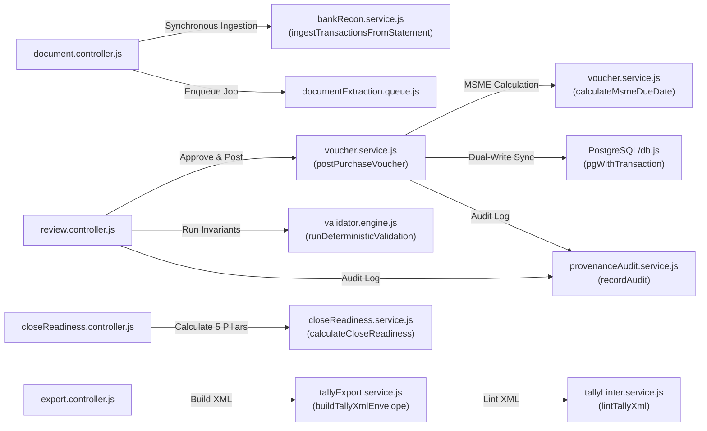
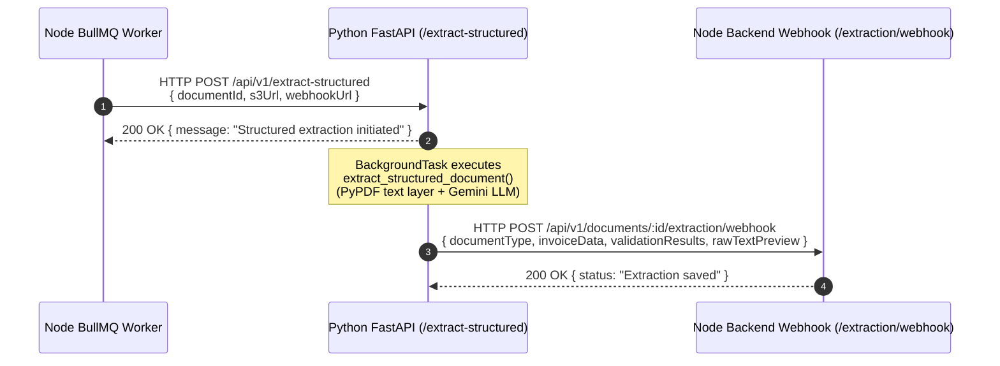

# Current Dependency & Coupling Map
## Project: CKsFinBot — Autonomous Accounting & Statutory Tax Advisory Platform
### Document ID: MAP-CKSFINBOT-PHASE0
### Date: 2026-11-14 | Status: Complete & Baselined
### Author: Principal Software Architect & Distributed Systems Engineer

---

## 1. Executive Summary

This document provides a comprehensive mapping of all inter-module, inter-service, and database dependencies in the existing **CKsFinBot** application. It identifies architectural coupling hotspots, model-sharing patterns, and synchronous cross-domain invocations that must be untangled during the migration to microservices.

---

## 2. Model Sharing Matrix (Shared Database Hotspot)

The table below maps each of the 22 business services to the Mongoose models it directly imports and accesses. This clearly illustrates the **Shared Database** anti-pattern currently present in the modular monolith:

| Business Service | User | Firm | Client | Document | Extracted Data | Voucher | Ledger Account | Bank Tx | GSTR-2B | Compliance Task | Document Request | Marketplace Settle | Processing Metric | Client Summary | Audit Log | Provenance Audit |
| :--- | :---: | :---: | :---: | :---: | :---: | :---: | :---: | :---: | :---: | :---: | :---: | :---: | :---: | :---: | :---: | :---: |
| **`voucher.service.js`** | | | | **W** | | **W** | **W** | | | | | | | | **W** | **W** |
| **`approval.service.js`** | | | **R** | | | **W** | | | | | | | | | **W** | |
| **`gstRecon.service.js`** | | | | | **R** | **R** | **R** | | **W** | | | | | | **W** | |
| **`taxAdvisory.service.js`** | | | | | **R** | **R** | **R** | | | | | | | | | |
| **`tallyExport.service.js`** | | | | | | **R** | **R** | | | | | | | | | |
| **`marketplaceSettlement.service.js`** | | | | | | **W** | **W** | **R** | | | | **W** | | | | |
| **`closeReadiness.service.js`** | | | **R** | **R** | | **R** | | **R** | **R** | | **R** | | | | | |
| **`clientSummary.service.js`** | | **R** | **R** | **R** | | **R** | | **R** | **R** | **R** | | | | **W** | | |
| **`financialReports.service.js`** | | | **R** | | | **R** | **R** | **R** | **R** | **R** | **R** | | | | | |
| **`bankRecon.service.js`** | | | | | | **R** | **R** | **W** | | | | | | | **W** | |
| **`compliance.service.js`** | | | | | | | | | | **W** | | | | | **W** | |
| **`documentRequest.service.js`** | | **R** | **R** | | | | | | | | **W** | | | | **W** | |
| **`duplicateDetector.service.js`** | | | | **R** | | **R** | | | | | | | | | | |
| **`firmAnalytics.service.js`** | | **R** | | **R** | | | | | | | | | **W** | | | |
| **`gsp.service.js`** | | | **W** | | | | | | | | | | | | **W** | |
| **`whatsapp.service.js`** | | | **R** | **W** | | | | | | | | | **W** | | | |
| **`rules.service.js`** | | | | | | | | | | | | | | | | | *(Uses Rule model)* |
| **`provenanceAudit.service.js`** | | | | | | | | | | | | | | | | **W** |

*Legend: **R** = Read query (`find`, `findOne`), **W** = Write mutation (`create`, `save`, `findByIdAndUpdate`).*

---

## 3. High-Coupling Visual Dependency Graph

```mermaid
flowchart TD
    subgraph HotspotModels["Shared Mongoose Models (Central Bottlenecks)"]
        M_Voucher[("Voucher.model")]
        M_Doc[("Document.model")]
        M_Client[("Client.model")]
        M_Ledger[("LedgerAccount.model")]
        M_Bank[("BankTransaction.model")]
        M_Gstr[("Gstr2b.model")]
    end

    subgraph ConsumingServices["Domain Services Directly Accessing Shared Models"]
        S_Voucher["voucher.service.js"]
        S_Recon["gstRecon.service.js"]
        S_Tax["taxAdvisory.service.js"]
        S_Close["closeReadiness.service.js"]
        S_Summary["clientSummary.service.js"]
        S_Market["marketplaceSettlement.service.js"]
        S_Reports["financialReports.service.js"]
        S_Dup["duplicateDetector.service.js"]
        S_Bank["bankRecon.service.js"]
    end

    S_Voucher -->|Mutates| M_Voucher
    S_Voucher -->|Mutates| M_Doc
    S_Voucher -->|Mutates| M_Ledger

    S_Recon -->|Queries| M_Voucher
    S_Recon -->|Mutates| M_Gstr
    S_Recon -->|Queries| M_Ledger

    S_Tax -->|Queries| M_Voucher
    S_Tax -->|Queries| M_Ledger

    S_Close -->|Queries| M_Voucher
    S_Close -->|Queries| M_Doc
    S_Close -->|Queries| M_Bank
    S_Close -->|Queries| M_Gstr
    S_Close -->|Queries| M_Client

    S_Summary -->|Queries 8 Models| M_Voucher & M_Doc & M_Bank & M_Gstr & M_Client

    S_Market -->|Creates| M_Voucher
    S_Market -->|Queries| M_Bank
    S_Market -->|Queries| M_Ledger

    S_Reports -->|Queries| M_Voucher & M_Ledger & M_Bank & M_Gstr & M_Client
```

---

## 4. Cross-Domain Service-to-Service Invocations

In addition to sharing database models, several controllers and services invoke other domain services synchronously within their execution path:

### Analysis of Critical Sync Calls:
1. **`review.controller.js` $\rightarrow$ `voucher.service.js`**:
   - When a human approves an extracted document in the Review Queue, `review.controller` directly executes `postPurchaseVoucher`.
   - `postPurchaseVoucher` synchronously performs ledger lookups, updates the MongoDB document, increments ledger account balances, logs provenance, and dual-writes to PostgreSQL.
   - *Target Microservice Architecture*: Review action emits `VoucherApprovalRequestedEvent`; Ledger service processes it asynchronously and publishes `VoucherCommittedEvent`.
2. **`document.controller.js` $\rightarrow$ `bankRecon.service.js`**:
   - Ingesting a bank statement document directly calls `ingestTransactionsFromStatement()`.
   - *Target Microservice Architecture*: Ingestion emits `StatementExtractedEvent`; Bank Reconciliation Service consumes it.
3. **`clientSummary.service.js` as an Aggregation Hotspot**:
   - Directly executes 8 separate `find()` queries across collections to assemble close metrics, GST match rates, and bank reconciliation status.
   - *Target Microservice Architecture*: Client Summary operates as a read-model projection (CQRS) updated incrementally via domain events.

---

## 5. Inter-Process Communication (Node.js $\leftrightarrow$ Python FastAPI)

The existing architecture uses a hybrid queue-and-webhook mechanism between the Node.js backend and Python AI service:

### Weaknesses in Current Node $\leftrightarrow$ Python Coupling:
- Python service requires knowledge of the Node backend's reachable external URL (`process.env.BACKEND_URL || "http://localhost:8080"`).
- If the Node backend is restarting or under deployment when Python completes extraction, the webhook fails.
- In-flight retries are managed via an ad-hoc in-memory queue when Redis is offline.
- *Target Microservice Architecture*: Both services communicate via RabbitMQ topic exchanges (`document.ingested` $\rightarrow$ Python consumes; Python publishes `document.extracted` $\rightarrow$ Validation service consumes).

---

## 6. Circular Dependency & Deadlock Risk Analysis

1. **Circular Dependency Scan**:
   - Static analysis confirms **zero circular module imports** currently exist (`A imports B imports A`). All imports follow a DAG (Directed Acyclic Graph) from Controllers $\rightarrow$ Services $\rightarrow$ Models/Utils.
2. **Dual-Write Deadlock Risk**:
   - In `voucher.service.js`, the code writes to MongoDB first, then enters a PostgreSQL transaction (`pgWithTransaction`).
   - If PostgreSQL fails or times out, the MongoDB record remains created while PostgreSQL lacks the voucher, resulting in a state mismatch.
   - *Target Microservice Architecture*: PostgreSQL is the primary single source of truth for the Ledger Service, combined with the **Transactional Outbox Pattern** to notify downstream services.

---

## 7. Audit Summary: What Must Be Decoupled

To achieve independent microservice deployment without breaking existing functionality:
1. **Decouple Data Models**: Eliminate direct cross-collection imports. Each service must only access its own models.
2. **Replace Synchronous Model Queries with Domain Events**: For example, when a voucher is created, instead of `closeReadiness.service.js` directly querying `Voucher.find()`, it maintains a local summary projection updated by `VoucherCommittedEvent`.
3. **Isolate Python Extraction behind RabbitMQ**: Eliminate the HTTP webhook callback in favor of persistent message queues.
4. **Preserve Pure Invariant Engines**: The logic inside `validator.engine.js`, `money.js`, `tallyLinter.service.js`, and `gstRecon.service.js` is already implemented as pure functions. These can be migrated cleanly into their respective target microservices without altering any calculation logic.

