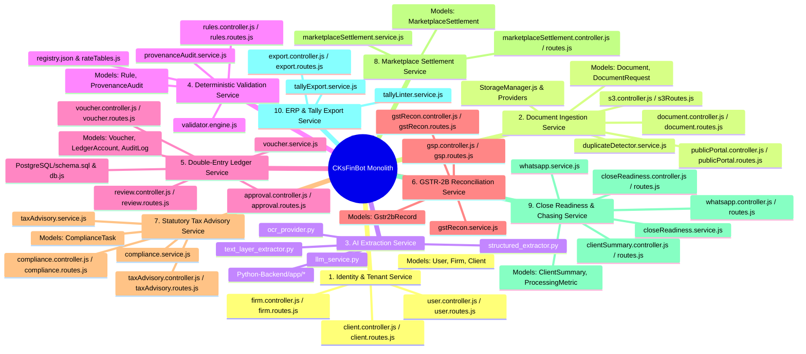
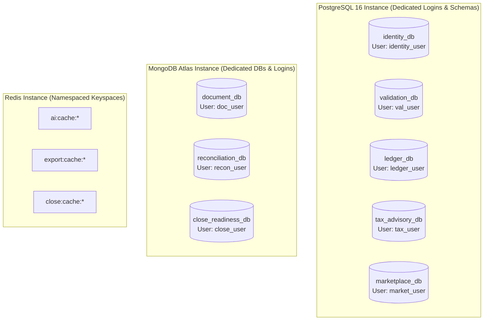
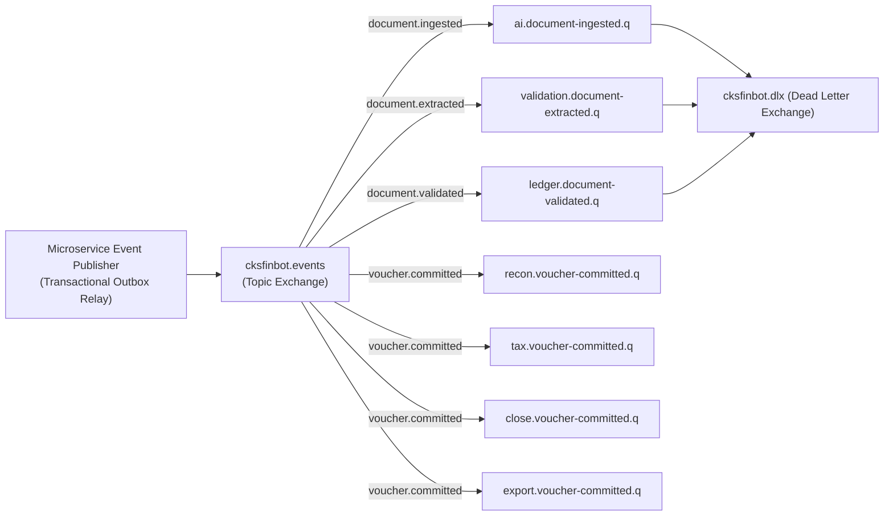
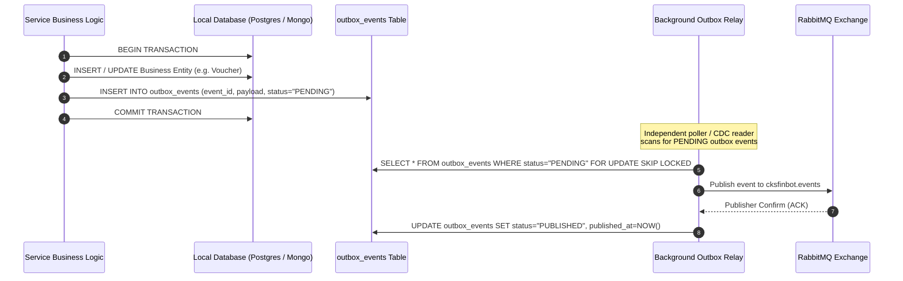
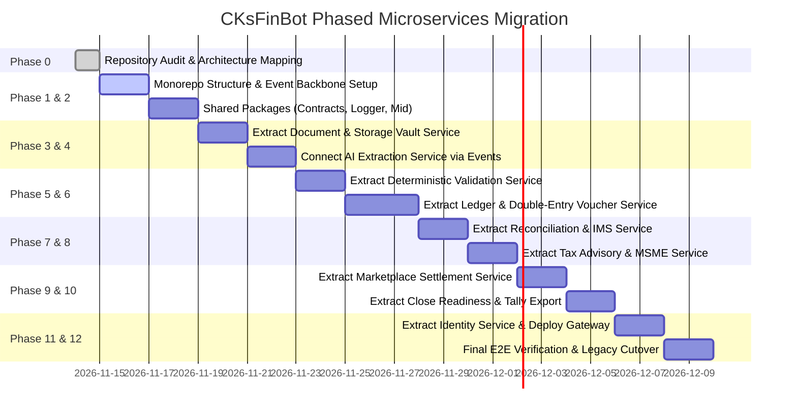

# Microservices Migration Plan & Domain Mapping
## Project: CKsFinBot — Autonomous Accounting & Statutory Tax Advisory Platform
### Document ID: PLAN-CKSFINBOT-PHASE0
### Date: 2026-11-14 | Status: 100% Executed & Verified (All 10 Microservices + Gateway Live)
### Author: Principal Software Architect & Distributed Systems Engineer

---

## 1. Executive Summary

This plan outlines the end-to-end strategy for transforming **CKsFinBot** from its current modular monolithic architecture into 10 independently deployable, event-driven microservices. The migration is designed around **Domain-Driven Design (DDD)**, **Database-per-Service**, the **Transactional Outbox Pattern**, and the **Strangler Fig Migration Pattern** to guarantee zero downtime and 100% backward compatibility for the React 19 frontend.

---

## 2. Complete File & Module Mapping to 10 Target Bounded Contexts

Every existing module, controller, route, service, and data model is mapped directly to its target microservice:



### Detailed Service Inventory:

#### Service 1: Identity & Tenant Management Service
- **Directory**: `services/identity-service/`
- **Existing Files to Migrate**:
  - `Node-Backend/src/Controllers/user.controller.js`
  - `Node-Backend/src/Controllers/firm.controller.js`
  - `Node-Backend/src/Controllers/client.controller.js`
  - `Node-Backend/src/Routes/user.routes.js`
  - `Node-Backend/src/Routes/firm.routes.js`
  - `Node-Backend/src/Routes/client.routes.js`
  - `Node-Backend/src/Middlewares/auth.middleware.js`
  - `Node-Backend/src/Middlewares/tenant.middleware.js`
  - `Node-Backend/src/Middlewares/rbac.middleware.js`
  - `Node-Backend/src/Models/user.model.js`
  - `Node-Backend/src/Models/firm.model.js`
  - `Node-Backend/src/Models/client.model.js`
- **Target Database**: **PostgreSQL** (`firms`, `clients`, `users`, `roles`).
- **Events Published**: `UserCreatedEvent`, `UserUpdatedEvent`, `TenantCreatedEvent`, `TenantUpdatedEvent`.

#### Service 2: Document Ingestion & Storage Vault Service
- **Directory**: `services/document-service/`
- **Existing Files to Migrate**:
  - `Node-Backend/src/Controllers/document.controller.js`
  - `Node-Backend/src/Controllers/s3.controller.js`
  - `Node-Backend/src/Controllers/publicPortal.controller.js`
  - `Node-Backend/src/Controllers/documentRequest.controller.js`
  - `Node-Backend/src/Routes/document.routes.js`
  - `Node-Backend/src/Routes/s3Routes.js`
  - `Node-Backend/src/Routes/publicPortal.routes.js`
  - `Node-Backend/src/Routes/documentRequest.routes.js`
  - `Node-Backend/src/Services/duplicateDetector.service.js`
  - `Node-Backend/src/Services/documentRequest.service.js`
  - `Node-Backend/src/Services/Storage/*`
  - `Node-Backend/src/Middlewares/multer.middleware.js`
  - `Node-Backend/src/Models/document.model.js`
  - `Node-Backend/src/Models/documentRequest.model.js`
- **Target Database**: **MongoDB** (`documents`, `documentRequests`).
- **Events Published**: `DocumentUploadedEvent`, `DocumentIngestedEvent`, `DocumentDuplicateDetectedEvent`.

#### Service 3: AI Document Extraction & OCR Service
- **Directory**: `services/ai-extraction-service/`
- **Existing Files to Migrate**:
  - Entire `Python-Backend/` codebase:
    - `app/api/endpoints.py`
    - `app/services/text_layer_extractor.py`
    - `app/services/structured_extractor.py`
    - `app/services/ocr_provider.py`
    - `app/services/reference_matcher.py`
    - `app/services/llm_service.py`
    - `app/services/multi_modal_processor.py`
    - `app/core/money.py`
- **Target Database**: **MongoDB** (stores raw OCR tokens and word bounding boxes) + **Redis** (ephemeral cache).
- **Events Consumed**: `DocumentIngestedEvent`.
- **Events Published**: `DocumentExtractionStartedEvent`, `DocumentExtractedEvent`, `DocumentExtractionFailedEvent`.

#### Service 4: Deterministic Validation & Statutory Rules Service
- **Directory**: `services/validation-service/`
- **Existing Files to Migrate**:
  - `Node-Backend/src/Rules/validator.engine.js`
  - `Node-Backend/src/Rules/registry.json`
  - `Node-Backend/src/Rules/rateTables.js`
  - `Node-Backend/src/Controllers/rules.controller.js`
  - `Node-Backend/src/Routes/rules.routes.js`
  - `Node-Backend/src/Services/rules.service.js`
  - `Node-Backend/src/Services/provenanceAudit.service.js`
  - `Node-Backend/src/Utils/money.js`
  - `Node-Backend/src/Utils/gstin.js`
  - `Node-Backend/src/Models/rule.model.js`
  - `Node-Backend/src/Models/provenanceAudit.model.js`
- **Target Database**: **PostgreSQL** (`rules_registry`, `rule_versions`, `provenance_audits`).
- **Events Consumed**: `DocumentExtractedEvent`.
- **Events Published**: `DocumentValidatedEvent`, `DocumentValidationFailedEvent`.

#### Service 5: Double-Entry Ledger & Voucher Service
- **Directory**: `services/ledger-service/`
- **Existing Files to Migrate**:
  - `Node-Backend/src/Controllers/voucher.controller.js`
  - `Node-Backend/src/Controllers/review.controller.js`
  - `Node-Backend/src/Controllers/approval.controller.js`
  - `Node-Backend/src/Routes/voucher.routes.js`
  - `Node-Backend/src/Routes/review.routes.js`
  - `Node-Backend/src/Routes/approval.routes.js`
  - `Node-Backend/src/Services/voucher.service.js`
  - `Node-Backend/src/Services/approval.service.js`
  - `Node-Backend/src/PostgreSQL/schema.sql`
  - `Node-Backend/src/PostgreSQL/db.js`
  - `Node-Backend/src/Utils/chartOfAccountsSeed.js`
  - `Node-Backend/src/Models/voucher.model.js`
  - `Node-Backend/src/Models/ledgerAccount.model.js`
  - `Node-Backend/src/Models/auditLog.model.js`
- **Target Database**: **PostgreSQL 16** (`general_ledger_accounts`, `financial_vouchers`, `voucher_lines`, `audit_logs`).
- **Events Consumed**: `DocumentValidatedEvent`, `VoucherApprovalRequestedEvent`.
- **Events Published**: `VoucherCreatedEvent`, `VoucherCommittedEvent`, `VoucherApprovedEvent`, `VoucherRejectedEvent`.

#### Service 6: GSTR-2B Reconciliation & IMS Service
- **Directory**: `services/reconciliation-service/`
- **Existing Files to Migrate**:
  - `Node-Backend/src/Controllers/gstRecon.controller.js`
  - `Node-Backend/src/Controllers/gsp.controller.js`
  - `Node-Backend/src/Routes/gstRecon.routes.js`
  - `Node-Backend/src/Routes/gsp.routes.js`
  - `Node-Backend/src/Services/gstRecon.service.js`
  - `Node-Backend/src/Services/gsp.service.js`
  - `Node-Backend/src/Models/gstr2b.model.js`
- **Target Database**: **MongoDB** (`gstr2b_inward_records`, `reconciliation_runs`).
- **Events Consumed**: `VoucherCommittedEvent`.
- **Events Published**: `GSTR2BReconciliationCompletedEvent`, `IMSActionRecordedEvent`, `ITCRiskDetectedEvent`.

#### Service 7: Statutory Tax Advisory & MSME Service
- **Directory**: `services/tax-advisory-service/`
- **Existing Files to Migrate**:
  - `Node-Backend/src/Controllers/taxAdvisory.controller.js`
  - `Node-Backend/src/Controllers/compliance.controller.js`
  - `Node-Backend/src/Routes/taxAdvisory.routes.js`
  - `Node-Backend/src/Routes/compliance.routes.js`
  - `Node-Backend/src/Services/taxAdvisory.service.js`
  - `Node-Backend/src/Services/compliance.service.js`
  - `Node-Backend/src/Models/complianceTask.model.js`
- **Target Database**: **PostgreSQL** (`compliance_calendar_tasks`, `tax_advisory_flags`, `msme_vendor_records`).
- **Events Consumed**: `VoucherCommittedEvent`.
- **Events Published**: `TaxRiskDetectedEvent`, `MSMEDeadlineApproachingEvent`, `MSMEOverdueEvent`.

#### Service 8: E-Commerce Marketplace Settlement Service
- **Directory**: `services/marketplace-service/`
- **Existing Files to Migrate**:
  - `Node-Backend/src/Controllers/marketplaceSettlement.controller.js`
  - `Node-Backend/src/Routes/marketplaceSettlement.routes.js`
  - `Node-Backend/src/Services/marketplaceSettlement.service.js`
  - `Node-Backend/src/Models/marketplaceSettlement.model.js`
- **Target Database**: **PostgreSQL** (`marketplace_settlements`, `settlement_lines`, `withholding_records`).
- **Events Published**: `MarketplaceSettlementImportedEvent`, `MarketplaceSettlementProcessedEvent`, `MarketplaceVoucherGeneratedEvent`.

#### Service 9: Month-End Close Readiness & Chasing Service
- **Directory**: `services/close-readiness-service/`
- **Existing Files to Migrate**:
  - `Node-Backend/src/Controllers/closeReadiness.controller.js`
  - `Node-Backend/src/Controllers/clientSummary.controller.js`
  - `Node-Backend/src/Controllers/whatsapp.controller.js`
  - `Node-Backend/src/Controllers/firmAnalytics.controller.js`
  - `Node-Backend/src/Routes/closeReadiness.routes.js`
  - `Node-Backend/src/Routes/clientSummary.routes.js`
  - `Node-Backend/src/Routes/whatsapp.routes.js`
  - `Node-Backend/src/Routes/firmAnalytics.routes.js`
  - `Node-Backend/src/Services/closeReadiness.service.js`
  - `Node-Backend/src/Services/clientSummary.service.js`
  - `Node-Backend/src/Services/whatsapp.service.js`
  - `Node-Backend/src/Services/firmAnalytics.service.js`
  - `Node-Backend/src/Models/clientSummary.model.js`
  - `Node-Backend/src/Models/processingMetric.model.js`
- **Target Database**: **MongoDB** (`client_summaries`, `close_readiness_snapshots`, `whatsapp_message_logs`).
- **Events Consumed**: `DocumentIngestedEvent`, `VoucherCommittedEvent`, `GSTR2BReconciliationCompletedEvent`, `TaxRiskDetectedEvent`.
- **Events Published**: `CloseReadinessUpdatedEvent`, `MissingDocumentDetectedEvent`, `ClientReminderDispatchedEvent`.

#### Service 10: ERP & TallyPrime Export Service
- **Directory**: `services/tally-export-service/`
- **Existing Files to Migrate**:
  - `Node-Backend/src/Controllers/export.controller.js`
  - `Node-Backend/src/Routes/export.routes.js`
  - `Node-Backend/src/Services/tallyExport.service.js`
  - `Node-Backend/src/Services/tallyLinter.service.js`
- **Target Database**: **Redis** (ephemeral export cache).
- **Events Consumed**: `VoucherCommittedEvent`.
- **Events Published**: `TallyExportGeneratedEvent`, `TallyExportFailedEvent`.

---

## 3. Database-per-Service Migration Strategy

To transition without deploying 10 physical database clusters during development, we enforce **logical isolation**:



### Database Ownership Rules:
1. Each microservice connects with its **own isolated database connection string and credentials**.
2. Service A **never** runs SQL queries or Mongoose operations against Service B's database.
3. No cross-service foreign keys. Foreign keys are replaced with immutable UUID / ObjectId string references (`documentId`, `firmId`, `clientId`, `voucherId`).
4. Read-side data aggregation (e.g. Client Summary) is achieved via **Event-Driven Projections** rather than multi-collection joins.

---

## 4. Event-Driven Communication Architecture (RabbitMQ)

### 4.1 Exchange & Routing Topology
- **Exchange Name**: `cksfinbot.events`
- **Exchange Type**: `topic`
- **Durable**: `true`
- **Publisher Confirms**: Enabled on all publishers.



### 4.2 Standard Event Envelope Schema
```json
{
  "eventId": "c7a8b9e0-1234-4567-89ab-cdef01234567",
  "eventType": "DocumentIngestedEvent",
  "eventVersion": 1,
  "occurredAt": "2026-11-14T02:30:00.000Z",
  "producer": "document-service",
  "correlationId": "f1e2d3c4-b5a6-7890-1234-56789abcdef0",
  "causationId": "a1b2c3d4-e5f6-7890-1234-56789abcdef0",
  "tenant": {
    "firmId": "672e811f0a12e9b04859a101",
    "clientId": "672e811f0a12e9b04859a102"
  },
  "payload": {
    "documentId": "6731e0b501d51a2e38b001a1",
    "fileHash": "9f86d081884c7d659a2feaa0c55ad015a3bf4f1b2b0b822cd15d6c15b0f00a08",
    "s3Key": "firms/672e811f0a12e9b04859a101/clients/672e811f0a12e9b04859a102/2026/file.pdf",
    "mimeType": "application/pdf"
  }
}
```

---

## 5. Transactional Outbox Pattern Design

For microservices that update a local database and publish events (e.g., `ledger-service`, `document-service`):



---

## 6. Strangler Fig Phased Migration Roadmap



### Phased Migration Sequence:
- **Stage 1 (Current)**: Phase 0 Audit & Baselining completed.
- **Stage 2**: Establish monorepo structure (`apps/`, `services/`, `packages/`, `infrastructure/`), RabbitMQ event bus, and shared packages (`packages/event-contracts`, `packages/shared-middleware`).
- **Stage 3**: Extract **Document Ingestion Service** (`services/document-service`). Route `/api/v1/documents/upload` to it.
- **Stage 4**: Connect **AI Document Extraction Service** (`services/ai-extraction-service`) to consume `DocumentIngestedEvent` and publish `DocumentExtractedEvent`.
- **Stage 5**: Extract **Deterministic Validation Service** (`services/validation-service`) to consume `DocumentExtractedEvent` and publish `DocumentValidatedEvent`.
- **Stage 6**: Extract **Ledger & Voucher Service** (`services/ledger-service`) with PostgreSQL double-entry constraints and maker-checker approvals.
- **Stage 7**: Extract **GSTR-2B Reconciliation Service** (`services/reconciliation-service`) driven by `VoucherCommittedEvent`.
- **Stage 8**: Extract **Statutory Tax Advisory Service** (`services/tax-advisory-service`).
- **Stage 9**: Extract **E-Commerce Marketplace Settlement Service** (`services/marketplace-service`).
- **Stage 10**: Extract **Close Readiness & Chasing Service** (`services/close-readiness-service`) and **Tally Export Service** (`services/tally-export-service`).
- **Stage 11**: Extract **Identity & Tenant Management Service** (`services/identity-service`) and deploy the centralized **API Gateway** (`apps/api-gateway`).
- **Stage 12**: Complete end-to-end invariant validation, load testing, and decommission monolithic routes.

---

## 7. Risk Register & Rollback Plan

| Risk | Likelihood | Impact | Mitigation Strategy | Rollback Plan |
| :--- | :---: | :---: | :--- | :--- |
| **Frontend Disruption** | Medium | High | API Gateway exposes identical `/api/v1/*` contracts. Frontend `apiClient.js` requires zero structural changes. | Gateway can instantly re-route traffic back to the legacy Node monolith endpoint. |
| **Message Broker Failure** | Low | High | RabbitMQ cluster with persistent queues + publisher confirms; outbox events remain stored in DB until broker ACK. | Events remain safely in `outbox_events` table; replay automatically resumes upon broker reconnect. |
| **Out-of-Order Events** | Medium | Medium | Events include monotonic `eventVersion` and timestamps; consumers enforce idempotency via processed event logs. | Consumers reject older event versions if a newer projection state already exists. |
| **Dual-Write Inconsistency** | Low | Critical | Eliminated by moving away from MongoDB/Postgres hybrid dual-writes to strict PostgreSQL ownership in Ledger service. | PostgreSQL ACID transactions ensure zero partial commits. |

