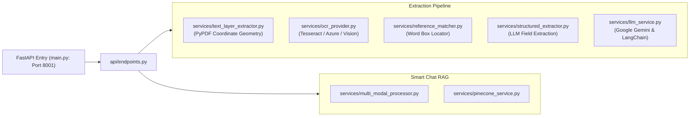
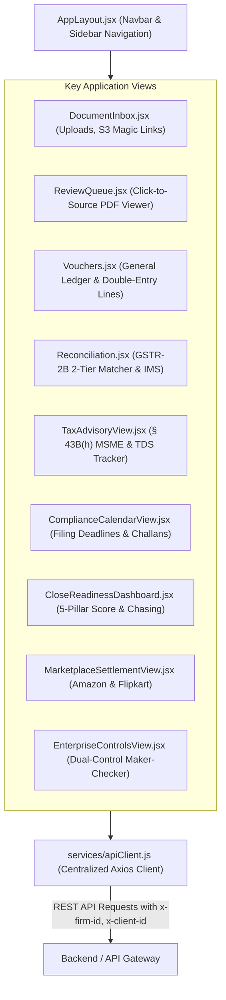

# Repository Discovery & Architectural Audit
## Project: CKsFinBot — Autonomous Accounting & Statutory Tax Advisory Platform
### Document ID: AUDIT-CKSFINBOT-PHASE0
### Date: 2026-11-14 | Status: Complete & Baselined
### Author: Principal Software Architect & Distributed Systems Engineer

---

## 1. Executive Summary

This document presents the complete Phase 0 architectural audit of the **CKsFinBot** repository. The existing codebase is a sophisticated, production-oriented fintech system that combines React 19, a Node.js Express application tier, a Python FastAPI document extraction tier, and a hybrid datastore (MongoDB Atlas, PostgreSQL 16, Redis 7, and AWS S3).

While functionally robust—boasting 36 passing invariant test suites, integer paise financial arithmetic, and a 0.00% False-Accept Rate (FAR) CI gate—the application currently operates as a **modular monolith** with tight cross-domain coupling, direct database imports across services, and synchronous inter-domain function calls.

This audit establishes the empirical baseline for migrating CKsFinBot to a **Domain-Driven, Event-Driven Microservices Architecture** without discarding any business logic or compromising financial invariants.

---

## 2. Complete Codebase Inventory

### 2.1 Node.js Express Backend (`Node-Backend/src`)
The Node.js backend serves as the primary business logic and API orchestration tier.

```mermaid
flowchart TD
    subgraph NodeMonolith["Node-Backend /src (Monolithic Runtime)"]
        Entry["index.js (HTTP + Socket.IO Server)\napp.js (Express Middleware & Routes)"]
        
        subgraph Controllers["25 Controllers"]
            C_Auth["user, firm, client, chat, conversation"]
            C_Doc["document, review, s3, publicPortal"]
            C_Fin["voucher, export, financialReports, approval"]
            C_Tax["taxAdvisory, rules, compliance"]
            C_Recon["gstRecon, bankRecon, gsp"]
            C_Ops["closeReadiness, clientSummary, whatsapp, marketplaceSettlement, dashboards, analytics"]
        end

        subgraph Services["22 Business Services"]
            S_Voucher["voucher.service.js, approval.service.js"]
            S_Recon["gstRecon.service.js, bankRecon.service.js, gsp.service.js"]
            S_Tax["taxAdvisory.service.js, rules.service.js, compliance.service.js"]
            S_Export["tallyExport.service.js, tallyLinter.service.js"]
            S_Close["closeReadiness.service.js, clientSummary.service.js, whatsapp.service.js"]
            S_Market["marketplaceSettlement.service.js"]
            S_Doc["duplicateDetector.service.js, documentRequest.service.js, provenanceAudit.service.js"]
            S_Store["StorageManager.js (S3, Cloudinary, Local)"]
        end

        subgraph Models["19 Mongoose Models (Shared MongoDB)"]
            M_Core["user, firm, client, ledgerAccount"]
            M_Doc["document, extractedData, documentRequest, bankTransaction"]
            M_Ledger["voucher, rule, provenanceAudit, auditLog"]
            M_Recon["gstr2b, marketplaceSettlement, complianceTask, clientSummary, processingMetric"]
            M_Chat["conversation, message"]
        end

        subgraph Infrastructure["Infrastructure & Helpers"]
            Q_Doc["Queues/documentExtraction.queue.js (BullMQ + In-Memory Fallback)"]
            RulesEng["Rules/validator.engine.js & registry.json"]
            PG_DB["PostgreSQL/db.js & schema.sql"]
            EvalGate["Eval/ciGate.js, syntheticGenerator.js, thresholds.json"]
            Utils["money.js, gstin.js, ApiError.js, ApiResponse.js"]
        end

        Entry --> Controllers
        Controllers --> Services
        Services --> Models
        Services --> Infrastructure
    end
```

#### Detailed Breakdown of Node.js Components:
1. **Entry Point & Server Setup** (`src/index.js`, `src/app.js`):
   - Single Node.js runtime process listening on `PORT` (default 8000/2590).
   - Socket.IO server mounted on the same HTTP server instance for real-time chat.
   - Global Express middleware: CORS (`allowedOrigins`), body parsers (`limit: "100mb"`), cookie-parser.
   - 25 route registrations mounted under `/api/v1/*`.
2. **Controllers** (25 files in `src/Controllers/`):
   - Handles HTTP request unwrapping, parameter extraction, and formatting JSON responses.
   - Many controllers directly instantiate and query Mongoose models rather than delegating solely to business services (e.g., `document.controller.js` directly manages `ExtractedData` and `Message`).
3. **Business Services** (22 files in `src/Services/`):
   - Contains rich financial and statutory logic:
     - `voucher.service.js`: Double-entry balancer, integer paise converter, MSME Section 43B(h) due-date calculator, dual-write to PostgreSQL.
     - `gstRecon.service.js`: 2-tier matching engine (exact match, assisted fuzzy match, record conservation guarantee, IMS actions).
     - `taxAdvisory.service.js`: Section 40(a)(ia) TDS, Section 40A(3) cash limits, Section 43B(h) MSME tracker.
     - `tallyExport.service.js` & `tallyLinter.service.js`: TallyPrime standard XML generator, polarity formatter (debits negative, credits positive), and schema linter.
     - `marketplaceSettlement.service.js`: Amazon MTR and Flipkart GSTR-8 flat-file parser and fee decomposer.
     - `closeReadiness.service.js`: 5-pillar close readiness scorer, recurring document gap detector.
4. **Data Models** (19 files in `src/Models/`):
   - All models inherit from a single Mongoose connection (`src/db/index.js`).
   - Cross-domain relationships are linked via Mongoose `ObjectId` references (`ref: "Firm"`, `ref: "Client"`, `ref: "Document"`, `ref: "Voucher"`).
5. **Background Queues** (`src/Queues/documentExtraction.queue.js`):
   - Uses BullMQ with an `IORedis` connection for asynchronous document extraction dispatch.
   - Includes an in-memory queue fallback when local Redis is unreachable.
   - Worker triggers HTTP calls directly to the Python FastAPI service.

---

### 2.2 Python FastAPI AI Microservice (`Python-Backend/app`)
The Python backend handles compute-heavy, vector, and multi-modal AI processing:

#### Detailed Breakdown of Python Components:
- **`app/main.py`**: FastAPI application instance with CORS middleware and `/api/v1` router mount.
- **`app/api/endpoints.py`**:
  - `POST /api/v1/extract-structured`: Main asynchronous document extraction worker using `BackgroundTasks`. Dispatches extraction and POSTs results back to Node.js webhook (`/api/v1/documents/:id/extraction/webhook`).
  - `POST /api/v1/process-document`: Ingests documents into Pinecone for RAG-based Smart Chat.
  - `POST /api/v1/query`: RAG query endpoint for financial conversational Q&A.
  - `POST /api/v1/suggest-improvement`: Document drafting inline improvement assistant.
- **`app/services/text_layer_extractor.py`**: Extracts exact character and word-level bounding boxes ($x_0, y_0, x_1, y_1$) directly from the PDF text layer using PyPDF.
- **`app/services/reference_matcher.py`**: Binds LLM-extracted values to exact word tokens located in the document geometry.
- **`app/core/money.py`**: Python implementation of integer paise arithmetic to maintain consistency with the Node backend.

---

### 2.3 React 19 Frontend (`Frontend/src`)
The user interface is a modern single-page application built with React 19, Vite, Tailwind CSS 4, and Framer Motion:

#### Frontend Integration Analysis:
- **Centralized Axios Client** ([`src/services/apiClient.js`](file:///d:/WORK/Project/CKsFinBot/Frontend/src/services/apiClient.js)):
  - Global request interceptor automatically injects `Authorization: Bearer <token>`, `x-firm-id`, and `x-client-id` from `localStorage`.
  - Global response interceptor handles 401 token refresh automatically via `/api/v1/users/refresh-token`.
  - All ~50 API methods are cleanly decoupled into modular functions, allowing the frontend to transparently target an API Gateway without requiring view-level refactoring.
- **Design Tokens** ([`src/index.css`](file:///d:/WORK/Project/CKsFinBot/Frontend/src/index.css)):
  - Fully migrated to CSS variables (`var(--surface)`, `var(--primary)`, `var(--border)`, etc.) supporting seamless Light and Dark mode toggling.

---

## 3. Data Tier & Storage Audit

### 3.1 MongoDB Atlas (Shared Database)
Currently, a single MongoDB database connection (`connectDB()` in `src/db/index.js`) is shared across all 19 collections.
- **Total Collections**: 19.
- **Tenancy Implementation**: Manual query filtering (`{ firm: req.firmId, client: req.clientId }`).
- **Cross-Collection Population**: Extensive use of Mongoose `.populate()`, creating tight physical coupling:
  - `Document` references `Client`, `Firm`, `ExtractedData`, `Voucher`, `Conversation`.
  - `Voucher` references `Document`, `Client`, `Firm`, `LedgerAccount`, `User`.
  - `ClientSummary` references `Firm`, `Client`.
  - `ExtractedData` references `Document`, `Firm`, `Client`.

### 3.2 PostgreSQL 16 (Strict Double-Entry Ledger)
Located in [`Node-Backend/src/PostgreSQL/`](file:///d:/WORK/Project/CKsFinBot/Node-Backend/src/PostgreSQL/):
- **`schema.sql`**: Defines relational tables:
  - `firms`
  - `clients`
  - `general_ledger_accounts`
  - `financial_vouchers`
  - `voucher_lines` (storing `amount_paise BIGINT NOT NULL CHECK (amount_paise > 0)`)
- **Database Trigger**:
  - `verify_voucher_double_entry_balance()` attached as a deferred constraint trigger (`trg_enforce_voucher_balance`).
  - Enforces that at transaction commit time:
    $$\sum_{\text{is\_debit=true}} \text{amount\_paise} = \sum_{\text{is\_debit=false}} \text{amount\_paise}$$
- **Current Operational Mode**: Hybrid dual-write. Vouchers are saved first in MongoDB, then opportunistically synced to PostgreSQL via `pgWithTransaction()` in `voucher.service.js`.

### 3.3 Redis & BullMQ
- **Connection**: `IORedis` client connecting to `REDIS_URL` (default `127.0.0.1:6379`).
- **Queues**:
  - `document-extraction`: Primary job queue for unstructured parsing.
  - `document-extraction-dlq`: Dead-letter queue for jobs failing after 3 exponential backoff attempts.
- **Job Payload**: Contains `{ documentId, firmId, clientId, s3Url, fileName }`.

### 3.4 AWS S3 Storage & Storage Manager
- **Abstraction**: [`src/Services/Storage/StorageManager.js`](file:///d:/WORK/Project/CKsFinBot/Node-Backend/src/Services/Storage/StorageManager.js) provides a provider interface with implementations for:
  - `S3StorageProvider.js` (AWS SDK v3 `@aws-sdk/client-s3`)
  - `LocalStorageProvider.js` (local filesystem)
  - `CloudinaryStorageProvider.js` (Cloudinary fallback)
- **Key Hierarchy**: Tenant-prefixed keys:
  `firms/{firmId}/clients/{clientId}/{category}/{fileHash}.ext`
- **Access Pattern**: Pre-signed short-lived URLs (15 minutes).

---

## 4. Key Architectural Anti-Patterns & Coupling Hotspots

Our audit identified several critical architectural anti-patterns that must be resolved during microservice migration:

| Anti-Pattern | Location in Codebase | Concrete Impact | Target Resolution |
| :--- | :--- | :--- | :--- |
| **Shared Database / Models** | `Services/*.service.js` directly import models from `Models/*.model.js` | Changes to one model break multiple domains; prevents independent database scaling. | **Database-per-Service**: Each service owns its tables/collections. |
| **God Service (ClientSummary)** | `clientSummary.service.js` imports 8 models across 6 domains | Single point of failure; joins data synchronously across Vouchers, GSTR-2B, Compliance, Documents, Bank, and Clients. | **CQRS / Event-Driven Projection**: Client Summary service consumes domain events to update its local read-model. |
| **Synchronous Cross-Domain Side Effects** | `voucher.service.js` lines 330–336 directly mutates `Document` status and `LedgerAccount` balance | Coupling between Ledger domain and Document domain; failure in document update rolls back voucher. | **Event Choreography**: Ledger publishes `VoucherCommittedEvent`; Document service updates its own status. |
| **Direct Webhook Callback to Monolith** | Python calls `/api/v1/documents/:id/extraction/webhook` | Python service must know the external hostname of Node backend; synchronous HTTP coupling. | **Message Broker (RabbitMQ)**: Python publishes `DocumentExtractedEvent` to topic exchange. |
| **Hardcoded Service URLs** | `documentExtraction.queue.js` line 42 (`http://localhost:8000/api/v1`) | Rigid environment deployment; fails in dynamic container networks without orchestration. | **Service Discovery & API Gateway**. |
| **Cross-Domain Data Enrichment** | `review.controller.js` imports `LedgerAccount` model to list ledgers | Review domain queries accounting chart of accounts directly. | **Local Projection or REST/gRPC Query**. |

---

## 5. Audit Conclusion

The existing business logic, validation rules, integer paise arithmetic, and financial schemas are of high quality and mathematically sound. They represent months of domain modeling and fintech engineering.

**The migration goal is strictly structural and infrastructural**:
1. Decouple these validated business functions into 10 independent bounded contexts.
2. Replace synchronous cross-model imports with asynchronous event pub/sub (RabbitMQ) and typed synchronous interfaces (REST/gRPC).
3. Migrate the shared database into dedicated database schemas/datastores per service.
4. Unify client traffic behind an API Gateway to maintain 100% backward compatibility with the React 19 frontend.

